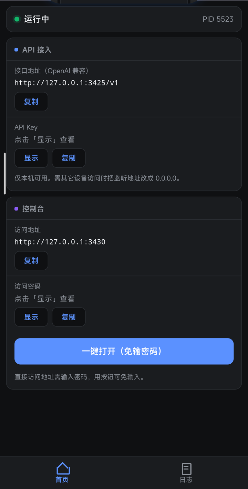

# Magpie AI 网关 · Android 模块

把 [magpie](https://github.com/yetone/magpie) 变成 Android 上的常驻服务：开机自己起来，被杀自己回来，一个按钮启停。

> 本仓库只含模块脚本，**不含 magpie 本体**（arm64 二进制约 74 MB）。模块假定 magpie 已装在 `/data/adb/magpie`。

模块只负责「让 magpie 在手机上稳定运行」，magpie 自身怎么配 provider、怎么选模型，以 [magpie 的文档](https://github.com/yetone/magpie/tree/main/docs)为准，这里不重复。

## 目录

- [为什么需要它](#为什么需要它)
- [能做什么](#能做什么)
- [快速开始](#快速开始)
- [日常使用](#日常使用)
- [客户端要填什么](#客户端要填什么)
- [两把密钥的区别](#两把密钥的区别)
- [配置](#配置)
- [工作原理](#工作原理)（折叠）
- [文件结构](#文件结构)
- [排障](#排障)
- [卸载](#卸载)
- [已知限制](#已知限制)
- [贡献者与致谢](#贡献者与致谢)

## 为什么需要它

[magpie](https://github.com/yetone/magpie) 是为桌面写的 Go 程序。搬到手机上能跑，但会连续撞上四件事：

- **DNS 查不到**。Go 找不到 `/etc/resolv.conf`，退回查 `::1:53`，日志里刷 `connection refused`。
- **HTTPS 全挂**。Go 只认 `/etc/ssl/certs/ca-certificates.crt` 这类固定路径，Android 上一个都没有——它的证书是 `/system/etc/security/cacerts/<hash>.0`，一证书一文件。
- **开机不自启**。Android 没有 systemd，重启之后得手动再起一次。
- **被杀就没了**。清理类 App、内存回收、系统「一键清理」都能直接 kill 掉它，而它自己不会回来。对下游客户端来说，这等于出口断了。

这个模块补上前三件，用看门狗解决第四件，并附一套能看见状态、能收拾干净的周边。

## 能做什么

| 能力 | 说明 |
| --- | --- |
| 开机自启 | 等 `sys.boot_completed` 后拉起，不阻塞开机 |
| 进程守护 | 20 秒巡检，被杀或回收后自动拉回；用户主动停止时不强行恢复 |
| 一键启停 | 点 `[执行]`：没跑就启动并打开网页面板，在跑就停止 |
| 状态可见 | 管理器描述实时显示「运行中 / 已停止」+ magpie 版本号 |
| 网页面板 | 状态、PID、接口地址、API Key、局域网地址、访问密码、日志尾 |
| 命令行 | `magpie` 自动进 PATH，补齐 `HOME`、`SSL_CERT_FILE`、`MAGPIE_BUN`、上游 DNS |
| CA 证书 | 合并系统根证书供静态 Go 使用，系统 CA 变化时自动重建 |
| 日志轮转 | 超过 5 MB 归档为 `.1`，只留一份 |
| 彻底卸载 | 停服务、收守护进程、清 PATH 链接、删数据目录，并复查残留 |

## 快速开始

### 前置条件

- Magisk v20.4+ / KernelSU / APatch，且**已经有 root**
- arm64 设备（magpie 本体是 arm64 ELF）
- magpie 本体已就位
- 会用管理器的「从本地安装」刷模块

### 步骤

**1. 放好 magpie 本体**

需要有 `/data/adb/magpie/bin/magpie`（可执行）和 `/data/adb/magpie/data` 目录：

```sh
su -c ls -l /data/adb/magpie/bin/magpie
su -c chmod 755 /data/adb/magpie/bin/magpie
```

本体不在这个位置的，先按 magpie 自己的方式装好，或把已有目录挪过来。

**2. 安装模块**

从 [Releases](https://github.com/KANGKKKKKKK/magpie-magisk/releases) 下载 `magpie-v0.5.zip`，管理器 → 模块 → 从本地安装 → 选 zip。

刷入时 `customize.sh` 会设好权限并检查本体；本体缺失**只提示，不中断安装**。

**3. 重启**

重启后模块会等 `sys.boot_completed` 再拉起服务，不需要解锁屏幕。

**4. 验证**

```sh
su -c sh /data/adb/modules/magpie/scripts/magpie.service status
# running (PID <pid>)
```

管理器模块页里那行描述也应从「点 [执行] 启动或停止」变成「magpie 运行中 (v…) | 点 [执行] 停止」。

**5. 打开面板**

服务已经在跑，**这时不要点 `[执行]`**——它此刻是停止按钮，点了会把服务关掉。直接取带密码的地址：

```sh
su -c cat /data/adb/magpie/run/web.url
# http://127.0.0.1:3430/?k=<32 位十六进制访问密码>
```

把输出的地址粘进浏览器。访问密码固定在 `/data/adb/magpie/data/web.key`，重启不变。

只有服务**已停止**时，点 `[执行]` 才会「启动并打开面板」。

不想刷 zip 的手动放置方式：

```sh
unzip magpie-v0.5.zip -d /data/adb/modules/magpie
chmod 755 /data/adb/modules/magpie/*.sh /data/adb/modules/magpie/scripts/*.sh
chmod 600 /data/adb/modules/magpie/scripts/magpie.config
```

## 日常使用

### 执行按钮

管理器模块页的 `[执行]` 是开关，行为取决于当前状态：

- 服务没跑 → 启动，然后打开带密钥的面板
- 服务在跑 → **停止**（写 `.user_stopped` 标记，看门狗不会马上又拉起来）

同一颗按钮，两种结果。用之前先看模块描述那行写的是「运行中」还是「已停止」。

### 网页面板

地址是 `http://127.0.0.1:3430/?k=<访问密码>`，密码见 `/data/adb/magpie/data/web.key`；不带 `?k=` 会返回 401。

面板显示：运行状态与 PID、OpenAI 兼容接口地址、API Key、WebUI 访问地址与访问密码、日志尾。「局域网地址」只在开放局域网后才出现。



（截图取自真实运行中的面板。API Key 与访问密码默认折叠为「点击「显示」查看」，未被截入。）

### 命令行

```sh
su -c magpie --version
# 示例输出：magpie 0.1.3620   ← 版本随本体更新而变，别把这里当固定值
```

`magpie` 由 `scripts/magpie-cli.sh` 包装，自动处理 Android 上缺的环境变量，用法与官方 CLI 一致。

### 服务控制

```sh
su -c sh /data/adb/modules/magpie/scripts/magpie.service start
su -c sh /data/adb/modules/magpie/scripts/magpie.service stop
su -c sh /data/adb/modules/magpie/scripts/magpie.service restart
su -c sh /data/adb/modules/magpie/scripts/magpie.service status
```

`start` 失败返回非 0，日志在 `/data/adb/magpie/run/magpie.log`。

## 客户端要填什么

magpie 对外是个 OpenAI 兼容网关，客户端只需要两项，面板首页都摆着：

| 要填的 | 值 |
| --- | --- |
| 接口地址（Base URL） | `http://127.0.0.1:3425/v1` |
| API Key | 下面命令打印出来的密钥 |

```sh
su -c magpie gateway-key add phone
# sk-magpie-key-…      ← 只打印这一次，当场存好
```

```sh
curl http://127.0.0.1:3425/v1/chat/completions \
  -H "Authorization: Bearer sk-magpie-key-…" \
  -H "Content-Type: application/json" \
  -d '{"model":"<provider>/<model>","messages":[{"role":"user","content":"hi"}]}'
```

- 模型名写 `<provider>/<model>`，可用哪些看 `magpie providers` 或 `GET /v1/models`。
- **前提是 magpie 里已经配好并启用了上游 provider**。只建网关 key 不会凭空变出模型；provider 怎么配以 [magpie 文档](https://github.com/yetone/magpie/tree/main/docs)为准。
- 同一个手机上的客户端用 `127.0.0.1` 即可；别的设备要连，得先按 [配置](#配置) 开放局域网，再把地址换成手机的局域网 IP。

Anthropic / Gemini 协议、模型分组、额度与并发限制这些都在 magpie 自己的文档里（[docs/integrating.md](https://github.com/yetone/magpie/blob/main/docs/integrating.md)），本模块不重复。

## 两把密钥的区别

模块里有**两把完全不同的密钥**：

|  | 网关 API Key | 面板访问密码 |
| --- | --- | --- |
| 长什么样 | 默认生成的形如 `sk-magpie-key-…`；用 `--key` 自填的格式随意 | 32 位十六进制 |
| 存哪 | `data/.config/magpie/caller-keys.json`（只存掩码展示，明文仅创建时打印一次） | `/data/adb/magpie/data/web.key` |
| 谁用 | 客户端调 `/v1` | 浏览器开面板（URL 里的 `?k=`） |
| 面板上叫 | API Key | 访问密码 |
| 怎么来 | `magpie gateway-key add <名>`，或 `add <名> --key <值>` 用自己的 | 首次启动自动生成，固定不变 |
| 作用 | 决定**谁能调用**、能用哪些模型与账号、多少额度 | 决定**谁能看见面板** |

`magpie gateway-key list` **不显示完整密钥**，只给 ID、状态和掩码（`sk-magpie-key-…4ff242`）。密钥只在 `add` 或 `rotate` 时打印一次，丢了就用 `rotate <id>` 换一个。

**本机回环访问不校验密钥。** magpie 官方文档的原话是「On this machine the gateway takes any key」，实测不带 `Authorization` 头也能调 `/v1/models`。所以「有没有 key」不是本机的安全边界，别拿它当。

面板会明文显示网关 API Key，因此访问密码泄露的后果不只是「看到运行状态」，而是「**可能拿到那把 API Key，并按它的权限调用模型**」——能调哪些模型、账号、额度仍由那把 key 的配置决定。

开放局域网后，暴露范围是：

- `MAGPIE_ADDR=0.0.0.0:3425` → 网关对局域网可见。**从别的设备访问必须带一把已启用的网关 key**，随便填字符串会被拒；但网关本身可被探测。
- `MAGPIE_WEB_ADDR=0.0.0.0:3430` → 面板暴露，不知道 `?k=` 会 401；密码一旦泄露，对方能打开面板并读到上面显示的 API Key。

顺序建议：**先建好网关 key，再开局域网**；只在本机用就保持默认的 `127.0.0.1`。不确定的话用 `ss -ltnp | grep -E '3425|3430'` 看实际监听地址，别只看配置。

## 配置

| 变量 | 默认值 | 说明 |
| --- | --- | --- |
| `magpie_path` | `/data/adb/magpie` | 数据目录，二进制 / 日志 / magpie 自身数据都在里面 |
| `MAGPIE_ADDR` | `127.0.0.1:3425` | API 网关监听地址 |
| `MAGPIE_WEB_ADDR` | `127.0.0.1:3430` | WebUI 监听地址；留空则用 `MAGPIE_ADDR` 的 host + 3430 |
| `MAGPIE_DNS` | `223.5.5.5 119.29.29.29 8.8.8.8` | 上游 DNS，空格分隔 |

脚本按顺序找配置文件：先 `/data/adb/magpie/scripts/magpie.config`，不存在才用模块里的 `scripts/magpie.config`。所以**改配置请改数据目录那份**，它不会被模块更新覆盖；两者都不在时使用内置默认值，且默认全部监听 `127.0.0.1`，不会意外把自己暴露到局域网。

改完重启服务生效：

```sh
su -c sh /data/adb/modules/magpie/scripts/magpie.service restart
```

## 工作原理

<details>
<summary>三个入口脚本各做什么（点开展开）</summary>

- **`service.sh`**：开机后等 `sys.boot_completed=1`，归档日志、启动服务、刷新状态；另外常驻一个 20 秒巡检的看门狗，发现进程没了就重新拉起。模块被禁用、正在卸载或目录被删时，看门狗自行退出。
- **`action.sh`**：读 PID 判断状态。停止后等进程真的退出才报结果，启动后等端口就绪才开网页；两条路径都刷新模块描述。
- **`scripts/magpie.service`**：真正的服务控制。启动前清理 v0.2 遗留的 dnsmasq、注入环境变量、拉起 `magpie serve --web=<addr>`、写 PID 与 WebUI 链接。

</details>

<details>
<summary>两个设计取舍：DNS 与 CA 证书（点开展开）</summary>

- **DNS 不占 53 端口**。用 Go 官方的 `DNS_LOCAL_HOSTNAMES` 直连公网 DNS，不启动本地 dnsmasq，因此不会和系统热点的 dnsmasq 抢端口——这是 v0.2 踩过的坑。
- **CA 证书自己更新**。给系统证书目录算指纹（文件数 + 目录 mtime，`/system/etc/security/cacerts` 与 APEX 那份一起算），存在 `ca-bundle.crt.stamp`；启动服务和调用 `magpie` 命令时比对，不一致就重建。先写临时文件、校验有证书才原子替换，失败保留旧包继续用。

  信任范围就是系统本来那些根证书：没有额外安装任何证书，没有中间人，也没有关掉校验。

</details>

## 文件结构

```
magpie-magisk/
├── module.prop                       模块信息（名字、版本、作者、描述）
├── customize.sh                      刷入时执行：设权限、查本体
├── service.sh                        开机自启 + 看门狗
├── action.sh                         管理器 [执行] 按钮
├── uninstall.sh                      卸载清理
├── build.sh                          打包成可刷入的 zip
├── scripts/
│   ├── magpie.service                start / stop / restart / status
│   ├── status.sh                     生成状态描述、status.json、日志尾
│   ├── magpie-cli.sh                 补环境变量后调用 magpie 本体
│   └── magpie.config                 配置（默认值）
├── webroot/
│   └── index.html                    网页面板
├── docs/
│   └── panel.png                     README 里的面板截图
└── META-INF/com/google/android/      Magisk 刷机脚本
```

运行时生成、不进仓库：

```
/data/adb/magpie/run/magpie.log        服务日志
/data/adb/magpie/run/watchdog.log      看门狗日志
/data/adb/magpie/run/web.url           带密码的面板地址
/data/adb/magpie/run/.user_stopped     用户主动停止的标记
/data/adb/magpie/run/magpie.pid        PID 文件
/data/adb/magpie/data/certs/           CA 证书包与指纹
webroot/status.json                    面板数据（含密钥，权限 600）
webroot/lastlog.txt                    面板日志尾（权限 600）
```

## 排障

| 现象 | 处理 |
| --- | --- |
| 启动失败，日志说端口占用 | 上次进程没退干净，`pidof magpie` 确认后 kill，再 `start` |
| 打开面板是 401 | 链接少了 `?k=`，从 `/data/adb/magpie/run/web.url` 取完整地址 |
| 点 `[执行]` 后面板没打开 | 服务当时在跑，按钮执行的是停止 |
| 客户端 404 | 接口地址漏了 `/v1` |
| 客户端 401 | 从别的设备访问时，key 必须是一把已启用的网关 key |
| 客户端报模型不存在 | 该模型没在 magpie 里启用，或那把 key 的 models 限制不含它 |
| 面板数据一动不动 | 属预期：读的是启停那一刻的快照 |
| 局域网连不上 | 改成 `0.0.0.0:<端口>` 后重启服务，并用 `ss -ltnp` 确认真的在监听 |
| HTTPS 报证书错误 | 删掉 `/data/adb/magpie/data/certs/ca-bundle.crt*` 再重启，会自动重建 |
| 停止后又自己起来 | 属预期：看门狗会把意外退出的进程拉回。要彻底关掉自愈，停用整个模块 |

## 卸载

管理器里移除模块，或手动执行：

```sh
su -c sh /data/adb/modules/magpie/uninstall.sh
```

会依次：写卸载标记让看门狗退出、停服务、收掉守护进程和插件宿主 `magpie-bun`、清理旧版 dnsmasq、移除 PATH 里的 `magpie` 链接、删除整个 `/data/adb/magpie`（设置、供应商、网关 key、用量记录、证书、Bun 缓存都在里面），最后复查残留。

**注意：数据目录会被整个删除，不会保留。**

## 已知限制

- 面板的运行时长、内存、日志尾是**启停时的快照**，不随时间刷新。
- 不含 magpie 本体；本体更新由 magpie 自己负责，模块只管调度。
- 只在 arm64 + Android 14（HyperOS 2.0）实测；理论上 Android 10+ 的 arm64 设备都适用。
- 旧版 dnsmasq 清理只针对 `listen-address=::1` 的老进程，不碰系统热点的 dnsmasq。

更多细节见 [CHANGELOG.md](CHANGELOG.md)。

## 贡献者与致谢

- [DeepSeek](https://github.com/deepseek-ai) —— 本项目的脚本整理与文档撰写在 DeepSeek 模型辅助下完成。
- [magpie](https://github.com/yetone/magpie) —— 本模块服务的对象，MIT 许可，官网 [usemagpie.ai](https://usemagpie.ai)。

## 许可证

模块脚本以 [MIT](LICENSE) 发布。magpie 本体不在本仓库内，为[第三方软件](https://github.com/yetone/magpie)，版权归其作者所有。

刷模块前请确认设备有可用的救砖手段。
