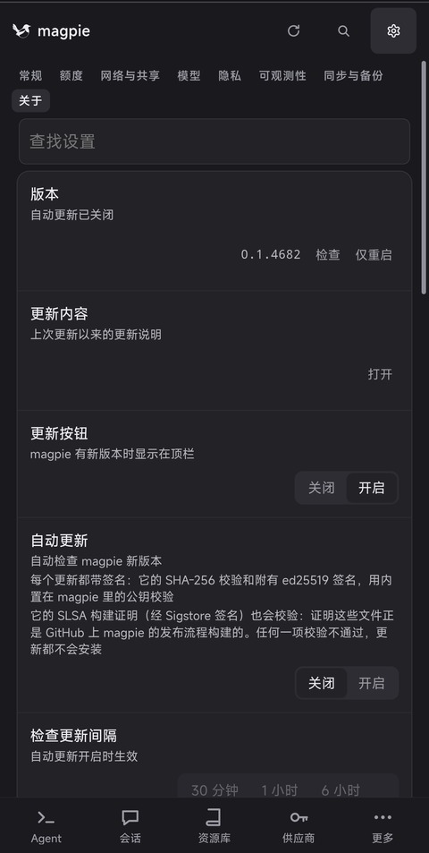
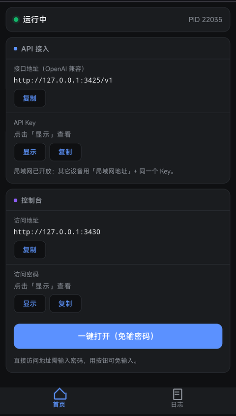
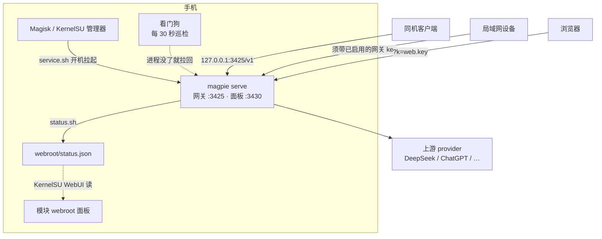

<div align="center">

# Magpie AI 网关 · Android 模块

把 [magpie](https://github.com/yetone/magpie) 变成 Android 上的常驻服务：开机自启，被杀自动拉回，`[执行]` 菜单里启停。

[](https://github.com/KANGKKKKKKK/magpie-magisk/releases)
[](LICENSE)
[](https://github.com/topjohnwu/Magisk)
[](#前置条件)
[](#快速开始)

**简体中文** | [English](README_EN.md)

</div>

> [!NOTE]
> 本仓库只含模块脚本，**不含 magpie 本体**（arm64 二进制）。本体没装也没关系：装上模块后点 `[执行]` 就能下载安装——首次点按只显示方案，再点一次才下载。当前下载大小以 `install.sh plan` 从清单读取的 `size` 为准。
>
> 模块只负责让 magpie 在这台手机上稳定运行；provider、模型、额度、账号这些属于 magpie 本体，不在本模块范围内。

## 目录

- [为什么需要它](#为什么需要它)
- [能做什么](#能做什么)
- [快速开始](#快速开始)
- [安装本体](#安装本体让模块来做)
- [日常使用](#日常使用)
- [客户端怎么接入](#客户端怎么接入)
- [两把密钥的区别](#两把密钥的区别)
- [配置](#配置)
- [自检与排障](#自检与排障)
- [工作原理](#工作原理)
- [文件结构](#文件结构)
- [卸载](#卸载)
- [更新](#更新)
- [控制中心磁贴（可选）](#控制中心磁贴可选)
- [已知限制](#已知限制)
- [开发与测试](#开发与测试)
- [贡献者与致谢](#贡献者与致谢)
- [许可证](#许可证)

## 为什么需要它

[magpie](https://github.com/yetone/magpie) 是为桌面写的 Go 程序。搬到手机上能跑，但会连续撞上四件事：

- **DNS 查不到**。Go 找不到 `/etc/resolv.conf`，退回查 `127.0.0.1:53` 与 `[::1]:53`，日志里刷 `connection refused`。
  更麻烦的是它只影响纯 Go 的请求路径：走 Bun 插件的供应商照常工作，所以表现为「有的模型能用、有的不能用」。
- **HTTPS 全挂**。Go 只认 `/etc/ssl/certs/ca-certificates.crt` 这类固定路径，Android 上一个都没有——它的证书是 `/system/etc/security/cacerts/<hash>.0`，一证书一文件。
- **开机不自启**。Android 没有 systemd，重启之后得手动再起一次。
- **被杀就没了**。清理类 App、内存回收、系统「一键清理」都能直接 kill 掉它，而它自己不会回来。对下游客户端来说，这等于出口断了。

这个模块补上前三件，用看门狗解决第四件，并附一套能看见状态、能自己检查问题的周边。

## 能做什么

| 能力 | 说明 |
| --- | --- |
| 开机自启 | 等 `sys.boot_completed` 后拉起，不阻塞开机 |
| 进程守护 | 30 秒巡检，被杀或回收后自动拉回；用户主动停止时不强行恢复 |
| 音量键菜单 | 点 `[执行]` 开菜单：切网关、看接入信息、启停、重启、开面板，音量键选、不用打字 |
| 状态可见 | 管理器那一行直接显示状态和可用地址（[示例](#执行按钮)），不用点按钮 |
| 自检 | `scripts/doctor.sh` 十项检查，直接告诉你哪里不对、下一步做什么 |
| 控制中心磁贴 | 可选装一个 40 KB 的 App，把启动/停止放进下拉栏；不装也不影响任何功能 |
| 命令行 | `magpie` 自动进 PATH，补齐 `HOME`、`SSL_CERT_FILE`、`MAGPIE_BUN`，并在 DNS 没配好时直说 |
| DNS 上游 | 模块自带 `system/etc/resolv.conf`，按 `MAGPIE_DNS` 重写；不启 dnsmasq，不占 53 端口 |
| CA 证书 | 合并系统根证书供 Go 静态 PIE 使用，系统 CA 变化时自动重建 |
| 日志轮转 | 超过 5 MB 归档为 `.1`，只留一份 |
| 在线更新 | 管理器里可直接收到新版本 |
| 安装本体 | 本体没装时，点 `[执行]` 就能下载并装好：sha256 校验、原子替换、失败不留残骸 |
| 彻底卸载 | 停服务、收守护进程、清 PATH 链接、删数据目录，并复查残留 |

## 快速开始

### 前置条件

- [ ] 设备已 root，且装了 Magisk / KernelSU / APatch 之一
- [ ] 架构是 **arm64**（magpie 本体是 arm64 ELF，arm32 / x86_64 跑不了）
- [ ] 会用管理器的「从本地安装」刷模块
- [ ] magpie 本体：有就用现成的，没有可以让模块装（见第 2 步）

> [!IMPORTANT]
> 本体没就位时服务不会启动，但**刷入模块本身不会失败**：只提示一句，看门狗也不会反复重试刷日志。装本体见[第 2 步](#步骤)。

> [!NOTE]
> `[执行]` 按钮由管理器提供，要求它支持模块的 `action.sh`——Magisk 从 27.0 起才有。更老的 Magisk、或管理器里根本没有这个按钮时，模块照样装得上、跑得起来，只是改用[命令行](#命令行)启停，能力一样。

### 步骤

**1. 安装模块**

从 [Releases](https://github.com/KANGKKKKKKK/magpie-magisk/releases) 下载最新的 `magpie-v*.zip`（文件名带版本号），管理器 → 模块 → 从本地安装 → 选 zip。

这一步**不需要先有 magpie 本体**：检测不到只提示一句，照样装完。

**2. 准备本体**

没有本体时，在管理器里点 `[执行]` 查看安装方案，确认后再点一次开始下载安装。
已经有可用本体则直接进入第 3 步。

<details>
<summary>命令行备选：检测或安装本体</summary>

```sh
su -c sh /data/adb/modules/magpie/scripts/install.sh status
# 示例：state=ready version=0.1.4302 path=/data/adb/magpie/bin/magpie

# 仅在需要安装或明确要重新部署时执行；--yes 会跳过确认，也允许覆盖已有本体
su -c sh /data/adb/modules/magpie/scripts/install.sh install --yes
```

</details>

细节与安全说明见[安装本体](#安装本体让模块来做)。

**3. 重启**

模块会等 `sys.boot_completed` 再拉起服务，不需要解锁屏幕。

这次重启也负责把 DNS 覆盖挂上（`system/etc/resolv.conf` → `/etc/resolv.conf`，Magisk 在开机时挂载）。跳过重启的话原生通道会一直解析失败，`doctor.sh` 的 `[8/10]` 会直接指出来。

**4. 验证**

```sh
su -c sh /data/adb/modules/magpie/scripts/magpie.service status
# running (PID <pid>)

su -c sh /data/adb/modules/magpie/scripts/doctor.sh   # 十项自检，出问题会告诉你怎么修
```

管理器里那行描述会从刷入时的静态文字变成「🟢 运行中 v… | 仅本机」；开过局域网之后则是「🟢 运行中 v… | 192.168.x.x:3425」。

**5. 打开面板**

点 `[执行]` → 选 6「打开面板」，会带着访问密码直接用浏览器打开。也可以自己取地址：

```sh
su -c cat /data/adb/magpie/run/web.url
# http://127.0.0.1:3430/?k=<32 位访问密码>
```

把打印出来的地址粘进手机浏览器即可。这是 magpie 本体的界面，别和[模块自带的 webroot 面板](#两个面板别弄混)弄混。

> [!TIP]
> 想从电脑上打开面板，先把 [配置](#配置) 里的 `MAGPIE_WEB_ADDR` 改成 `0.0.0.0:3430` 并重启服务，再用面板/自检里给出的局域网地址访问。**开之前先看一眼下面的[两把密钥](#两把密钥的区别)那一节。**

**6. 配好供应商，收到第一条回复**

在刚打开的 **magpie 本体面板（P1）** 中添加或登录至少一个供应商（provider），
启用要使用的模型；已有配置可以跳过。模块只负责运行服务，不会附送账号、模型或额度。

接着按[客户端怎么接入](#客户端怎么接入)选择本机或局域网方案，从模型目录复制实际模型 ID，
在客户端发一条消息。**收到模型回复才算完成接入**；只看到进程运行或面板打开，还没有验证上游调用。

<details>
<summary>进阶：不通过管理器刷入，手动解压模块</summary>

```sh
unzip magpie-v*.zip -d /data/adb/modules/magpie   # 换成实际下载到的文件名
chmod 755 /data/adb/modules/magpie/*.sh /data/adb/modules/magpie/scripts/*.sh
chmod 600 /data/adb/modules/magpie/scripts/magpie.config
```

仍需按上面的步骤准备本体并重启手机；普通用户优先使用管理器安装。

</details>

## 安装本体（让模块来做）

本体没装时，`[执行]` 不再是音量键菜单，而是安装入口。命令行也一样：

```sh
su -c sh /data/adb/modules/magpie/scripts/install.sh status    # 只检测
su -c sh /data/adb/modules/magpie/scripts/install.sh check     # 联网比版本，不下载
su -c sh /data/adb/modules/magpie/scripts/install.sh plan      # 打印将装什么，不下载
su -c sh /data/adb/modules/magpie/scripts/install.sh install   # 先给方案，再点一次才下载
su -c sh /data/adb/modules/magpie/scripts/install.sh install --yes   # 直接装
su -c sh /data/adb/modules/magpie/scripts/install.sh rollback  # 用备份退回
```

<details>
<summary>下载来源、校验与回退机制</summary>

**从哪来。** 清单是 `https://usemagpie.ai/api/latest` —— magpie 自己的更新端点，
`magpie update` 用的也是它；资产名 `magpie-cli-android-arm64`（实测这是发布页里唯一的 Android 构建，
没有 arm32 的）。下载优先走厂商 CDN，失败再退回 GitHub。

**怎么校验。** 清单给出 `size` 和 `sha256`，下载后逐项比对，对不上就丢弃换下一个来源。
`SHA256SUMS` 与 GitHub API 的 `digest` 字段两者与该值一致。**注意**：sha256 来自同一个清单，
所以真实性的信任根是「usemagpie.ai 这个源 + TLS」，与 magpie 本体自己更新时的信任假设相同；
仓库里虽然也有 `SHA256SUMS.sig`，但本模块没有内置公钥，因此**不声称做过 GPG 签名验证**。

**怎么落盘。** 先下到同文件系统的临时文件 → 校验 → `mv` 原子替换（不会出现半截文件）；
替换前把旧本体备份成 `bin/magpie.bak`。装完立刻跑一次 `--version` 自检：跑不起来就回退；
首次安装没有备份可退时，把失败样本挪到 `bin/magpie.rejected` 并报出它的 sha256，
正式路径上绝不留下「看起来已安装」的文件。

**不做什么。** 不自动下载、不每次开机检查、不自动升级、不覆盖已有可用本体（除非显式
`install --yes`）、不碰 `data/`、配置、账号、provider、密钥、监听地址。升级交给本体自己：

```sh
su -c magpie update check   # 只看有没有新版
su -c magpie update         # 下载、校验、重启进新版本
```

</details>

> [!NOTE]
> 刷入模块时**不会**联网下载。刷机流程里没有可靠的交互终端，因此 `customize.sh` 只做检测并告诉你怎么装，真正下载由你确认后触发。

> [!NOTE]
> 安装器不依赖 `wget` 在 `PATH` 上。模块脚本被管理器拉起时，`PATH` 往往只有系统目录，
> 那里没有 `wget`；安装器会把各 Root 方案的 bin 目录加进去，并在必要时回退到
> busybox 自带的 `wget`。可用 `MAGPIE_DL=/path/to/curl` 指定别的下载器。

> [!TIP]
> 想换源（自建镜像、内网缓存）：
> `MAGPIE_MANIFEST_URL=https://内网/… sh install.sh install --yes`。
> 清单格式不变时可用。资产名也可用 `MAGPIE_ASSET_KEY` 覆盖。

## 日常使用

### 执行按钮

管理器模块页的 `[执行]` 是一个**音量键菜单**。点开后不需要打字，也不需要终端：

```
───────────  Magpie  ───────────
 状态  运行中
 网关  局域网 · 其他设备可连接
 地址  192.168.1.5
────────────────────────────────
   1  切到「仅本机」
 ▸ 2  查看接入信息
   3  重启
   4  停止
   5  启动
   6  打开面板
   7  退出
────────────────────────────────
 音量下 换一项 · 音量上 执行
 60 秒没按键就自动退出
```

**音量下 = 换一项，音量上 = 执行**，60 秒没按键自动退出。各选项：

| 选项 | 作用 |
| --- | --- |
| 1 切换网关 | 同时切换 API 和管理面板的监听地址：仅本机 `127.0.0.1` / 局域网 `0.0.0.0`；服务在跑就自动重启生效 |
| 2 查看接入信息 | 本机与局域网两套地址分行列出，并给出别的设备该填什么 |
| 3 / 4 / 5 | 重启 / 停止 / 启动 |
| 6 打开面板 | 用浏览器打开 WebUI（带你自己的密钥） |
| 7 退出 | 关掉 `[执行]` 窗口，回到模块列表 |

本体没装或跑不起来时，`[执行]` 仍然是安装入口：先打印将装的版本、大小、来源，
再点一次才开始下载。

> [!TIP]
> **开热点给平板用时**：先点 `[执行]` → 选 1 切到「局域网」→ 选 2 看给出的地址，
> 把它填进平板上 Eta 的 magpie 接口；用完再切回「仅本机」，外部就进不来。

> [!WARNING]
> 菜单切到局域网会**同时开放 API 网关和管理面板**（默认 3425 / 3430）。两者默认使用 HTTP，
> 不加密传输，只在可信网络使用，不要直接暴露到公网。只想共享 API、不想开放面板，
> 请按[配置](#配置)单独设置 `MAGPIE_ADDR=0.0.0.0:3425`，保持 `MAGPIE_WEB_ADDR=127.0.0.1:3430`，再重启服务。

音量键本身会系统性地调一下媒体音量，菜单退出时会还原成进来时的值。
在终端里跑同一个菜单（见 [命令行](#命令行)）时会原地重画、只有 `▸` 移动；
Magisk 的文本框不支持光标控制，所以那里只画一次菜单、每按一次追加一行当前选中项。

那行文字会自动更新，不需要点任何按钮就能看到该填进客户端什么：

```
🟢 运行中 v0.1.4260 | 192.168.1.5:3425      ← 运行中，并给出可用的局域网地址
🟢 运行中 v0.1.4260 | 仅本机                 ← 只监听 127.0.0.1，别的设备连不上
🔴 已停止 | 点 [执行] 启动
```

地址变了（WiFi 重连、热点开关、切飞行模式）会自动刷新，不会让你照着旧地址折腾。字体不支持 emoji、显示成方框时，把配置里的 `MAGPIE_ICON` 设成 `0`，就会换成 `[运行中]` / `[已停止]` 纯文本。

> [!NOTE]
> 管理器里没有 `[执行]` 按钮时（见[前置条件](#前置条件)），用下面的命令行启停，效果一样。

### 两个「面板」，别弄混

有两个完全不同的页面，地址和用途都不一样。下面把 magpie 本体那个叫 **P1**、模块自带那个叫 **P2**，后文不再说左右：

<p align="center"> </p>

**P1**：magpie 自带的面板，截图停在「关于」页（版本号、更新开关）；日常配模型、供应商、额度、密钥都在这里。  
**P2**：模块自带的 webroot 面板，要靠 KernelSU WebUI / WebUI-X 托管才能打开；里面的 API Key 与访问密码默认折叠为「点击「显示」查看」，截图未展开。

| | P1：magpie 自带的面板 | P2：模块自带的 webroot 面板 |
| --- | --- | --- |
| 地址 | `http://<host>:3430/?k=<data/web.key>`；也可以用 `[执行]` → 6 打开 | 没有自己的地址：在 KernelSU WebUI / WebUI-X 里打开 |
| 谁提供 | magpie 自己（`serve --web=…`） | `webroot/index.html`，需要 **KernelSU 的 WebUI** 或 Magisk 的 **WebUI-X** 模块来托管 |
| 能看到什么 | magpie 的完整应用界面（Agent、会话、资源库、供应商、网关、额度、模型、插件、设置…） | 服务状态与 PID、网关地址与 API Key、面板地址与访问密码、日志尾 |
| 纯 Magisk 下 | ✅ 可用，地址由 `run/web.url` 给出 | ❌ 没有宿主就打不开；此时 `webroot/status.json` 仍然会写，脚本可以直接读 |

### 命令行

```sh
su -c magpie --version
# 示例输出：magpie 0.1.3620   ← 版本随本体更新而变，别把这里当固定值
```

`magpie` 由 `scripts/magpie-cli.sh` 包装，自动处理 Android 上缺的环境变量，用法与官方 CLI 一致。

### 服务控制

```sh
su -c sh /data/adb/modules/magpie/scripts/magpie.service start
su -c sh /data/adb/modules/magpie/scripts/magpie.service stop
su -c sh /data/adb/modules/magpie/scripts/magpie.service restart
su -c sh /data/adb/modules/magpie/scripts/magpie.service status
su -c sh /data/adb/modules/magpie/scripts/doctor.sh          # 十项自检
```

`start` 失败返回非 0，日志在 `/data/adb/magpie/run/magpie.log`。

### [执行] 菜单的命令行版本

菜单里能做的事，都能带参数直接调（终端 / Tasker / 快捷方式），不需要按键：

```sh
su -c sh /data/adb/modules/magpie/action.sh           # 音量键菜单，与点 [执行] 相同
su -c sh /data/adb/modules/magpie/action.sh status    # 接入信息（本机 + 局域网 + 进程号）
su -c sh /data/adb/modules/magpie/action.sh gateway   # 当前网关 + 配置里那两行
su -c sh /data/adb/modules/magpie/action.sh lan       # 切到局域网（别的设备可连）
su -c sh /data/adb/modules/magpie/action.sh local     # 切回仅本机
su -c sh /data/adb/modules/magpie/action.sh start     # 启动
su -c sh /data/adb/modules/magpie/action.sh stop      # 主动停止，看门狗不会拉回
su -c sh /data/adb/modules/magpie/action.sh restart   # 重启
su -c sh /data/adb/modules/magpie/action.sh panel     # 打开面板
```

切网关只改配置里的 `MAGPIE_ADDR` / `MAGPIE_WEB_ADDR` 两行，服务在跑就自动重启一次生效。

## 客户端怎么接入

### 接入前检查

- [ ] 服务在跑；不确定就执行下面的十项自检。
- [ ] 已在 **magpie 本体面板（P1）** 配好至少一个供应商，并启用要使用的模型。
- [ ] 选择下方的本机或局域网方案。局域网访问另需一把**已启用**的网关 key。

```sh
su -c sh /data/adb/modules/magpie/scripts/doctor.sh
```

### 第一步：按使用场景拿到地址和密钥

#### 同一台手机使用

保持默认的「仅本机」即可，不必开放局域网。

| 客户端字段 | 填写内容 |
| --- | --- |
| 接口地址（Base URL） | `http://127.0.0.1:3425/v1` |
| API Key | 可填 `magpie-myapp` 作为本机客户端标识，也可用自己的网关 key |
| 模型 ID | 从 `GET /v1/models` 返回的 `id` 原样复制，见下一步 |

本机回环访问不校验 key，**这不代表局域网也能随便填**；详见[两把密钥的区别](#两把密钥的区别)。

#### 平板 / 电脑通过局域网使用

1. 先在 magpie 中准备一把已启用的网关 key。也可以用命令行创建：

   ```sh
   su -c magpie gateway-key add tablet
   # 保存本次返回的完整密钥，不要把它发到公开截图或日志里
   ```

2. 让两台设备连接同一个可互通的 Wi-Fi，或让平板 / 电脑连上手机热点。
3. `[执行]` → 选 1 切到「局域网」，再选 2 查看接入信息。
4. 客户端填写 `http://<手机局域网IP>:3425/v1`、刚才的完整 key，以及模型目录中的实际 ID。
   例如 `http://192.168.1.100:3425/v1`；不要在另一台设备上填写 `127.0.0.1` 或 `0.0.0.0`。

> [!WARNING]
> 局域网开关会同时开放 API 和管理面板，默认是 HTTP。只在可信网络使用；
> 仅共享 API 的配置方法见[执行按钮](#执行按钮)。API key 与面板链接中的 `?k=` 不是一回事。

> [!NOTE]
> CLI 的 `gateway-key list` 不提供可用于接入的完整明文；创建或 `rotate` 后立即保存完整 key，
> 不要把掩码复制进客户端。丢失时可用 `magpie gateway-key rotate <id>` 换一把，随后更新使用旧 key 的客户端。
> 模块状态面板（P2）中的显示值取决于本体版本和状态采集结果，不应作为完整密钥的唯一备份。

### 第二步：填入客户端并选择实际模型 ID

下面是按标准 OpenAI Base URL 拼接路径的配置示例，不是所有客户端通用的导入文件。

```jsonc
{
  "base_url": "http://127.0.0.1:3425/v1",  // 其他设备换成手机局域网 IP
  "api_key":  "magpie-myapp",             // 仅本机示例；局域网必须换成已启用的网关 key
  "model":    "<从 /v1/models 复制的 id>"
}
```

- 在客户端点击「获取模型」或「刷新模型」；也可用下一步的 `GET /v1/models` 查询。
- 普通模型 ID 通常形如 `deepseek/deepseek-chat`；**路由组则直接使用组名**。一律以返回的 `id` 为准，
  不要给路由组擅自加供应商前缀，也不要把显示名称当成模型 ID。
- 不同客户端对地址的补全规则不同：填 Base URL 时通常包含 `/v1`；如果客户端会自动补 `/v1`，
  则填网关根地址。若要求完整端点，填完整请求路径。最终请求应到达
  `/v1/chat/completions` 或 `/v1/responses`，不能漏掉 `/v1`，也不能重复成 `/v1/v1/...`。

<details>
<summary>其他协议的常用 Base URL（Anthropic / Gemini）</summary>

```text
OpenAI     http://127.0.0.1:3425/v1        # /v1/chat/completions、/v1/responses
Anthropic  http://127.0.0.1:3425           # /v1/messages
Gemini     http://127.0.0.1:3425           # /v1beta/models/{model}:generateContent
```

其他设备同样替换主机地址，具体仍以客户端的路径拼接方式为准。
协议与模型目录说明见 [magpie 的接入文档](https://github.com/yetone/magpie/blob/main/docs/integrating.md)。

</details>

### 第三步：验证连接并收到回复

最简单的方法是在客户端获取模型列表，再选一个模型发送 `hi`。**能列出模型不等于上游调用成功**：
还要收到真实回复，才验证了供应商登录、额度和调用链路。

有 `curl` 7.76+ 的终端（例如电脑或 Termux）也可以分两步检查。以下是 POSIX Shell 示例，
`BASE_URL` **包含 `/v1`**，后面的请求始终使用同一个地址，不会在电脑上误连自己的回环端口。

```sh
# 同一台手机：
BASE_URL='http://127.0.0.1:3425/v1'
API_KEY='magpie-myapp'

# 如果是在平板 / 电脑上执行，改用下面两项，并替换示例 IP 与 key：
# BASE_URL='http://192.168.1.100:3425/v1'
# API_KEY='<已启用的完整网关key>'

# 1. 查询模型 ID；每行一个
curl --fail-with-body -sS --connect-timeout 5 --max-time 30 \
  -H "Authorization: Bearer $API_KEY" "$BASE_URL/models?format=text"
```

从结果中复制一个实际 ID，替换下面的 `<模型ID>`，在同一个终端继续执行。
这一步会调用上游模型，可能消耗额度。

```sh
# 2. 发一条真实消息；路由组直接填组名
curl --fail-with-body -sS --connect-timeout 5 --max-time 120 \
  "$BASE_URL/chat/completions" \
  -H "Authorization: Bearer $API_KEY" \
  -H 'Content-Type: application/json' \
  -d '{"model":"<模型ID>","messages":[{"role":"user","content":"hi"}]}'
```

手机上没有 `curl` 时，用开头的 `doctor.sh` 检查模块状态，再直接在客户端完成模型列表和消息测试，
不必为了接入额外安装命令行工具。自检通过只说明它检查的项目正常，不代替真实模型调用。

<details>
<summary>连接失败排查（FAQ）</summary>

| 现象 | 检查方向 |
| --- | --- |
| `Connection refused` / 连接被拒绝 | 服务没跑、端口不对或只监听本机；运行 `doctor.sh` 检查进程与端口 |
| 电脑连不上，手机正常 | 确认已开放 API 的局域网监听；电脑使用的是手机的局域网地址，不是 `127.0.0.1` |
| 超时，不报拒绝 | 检查 Wi-Fi / 热点互通、路由器 AP 隔离、防火墙和手机 IP 是否变化 |
| 404 | 检查客户端最终请求路径；可能缺少 `/v1`、重复 `/v1`，或选错 API 协议 / 端点 |
| API 返回 401 | 局域网必须使用已启用的完整网关 key，不能填面板访问密码、占位符或掩码 |
| `model not found` | 从 `/v1/models` 重新复制 `id`，检查模型启用状态及该 key 的模型权限 |
| 列表有模型，发消息失败 | 查看返回的错误和日志，检查供应商登录、额度、上游网络及模型能力 |
| 面板打开是 401 | 使用 `run/web.url` 的完整地址，或 `[执行]` → 选 6；不要把面板密码填进 API Key |
| 模块面板的 API Key 显示「点击「显示」查看」 | 这是默认折叠显示；若只有掩码，仍需使用创建或轮换时保存的完整 key |

</details>

## 两把密钥的区别

|  | 网关 API Key | 面板访问密码 |
| --- | --- | --- |
| 长什么样 | 默认生成的形如 `sk-magpie-key-…`；用 `--key` 自填的格式随意 | 32 位十六进制 |
| 存哪 | `/data/adb/magpie/data/.config/magpie/caller-keys.json`（由本体管理；不要手改或当作密钥备份） | `/data/adb/magpie/data/web.key` |
| 谁用 | 客户端调 `/v1` | 浏览器开面板（URL 里的 `?k=`） |
| 怎么来 | `magpie gateway-key add <名>`，或 `add <名> --key <值>` 用自己的 | 首次启动自动生成，重启不变 |
| 作用 | 决定**谁能调用**、能用哪些模型与账号、多少额度 | 决定**谁能看见面板** |

`?k=` 的流程是：带上正确密码的第一个请求返回 303 并写入登录 cookie，之后浏览器凭 cookie 访问。所以地址里的 `?k=` 只需要第一次带上。

> [!IMPORTANT]
> **本机回环访问不校验密钥。** magpie 文档的原话是「On this machine the gateway takes any key」，实测不带 `Authorization` 头也能调通 `/v1/models`。所以「有没有 key」不是本机的安全边界，别拿它当。

本体面板（P1）能管理供应商、账号和网关密钥，不只是查看运行状态；模块面板（P2）的状态文件也可能含敏感值。
**不要分享带 `?k=` 的完整链接、密钥截图或 `status.json`**，也不要因为界面默认折叠就把它当作脱敏。

开放局域网后的暴露面：

- `MAGPIE_ADDR=0.0.0.0:3425` → 网关对同网段可见。**从别的设备访问必须带一把已启用的网关 key**，随便填字符串会被拒；但网关本身可被探测。
- `MAGPIE_WEB_ADDR=0.0.0.0:3430` → 面板暴露，不知道 `?k=` 会 401；密码一旦泄露，对方可能进入管理界面，影响供应商和密钥配置。

局域网菜单会同时修改上面两项，默认使用 HTTP、没有 TLS；仅在可信网络使用，不要直接转发到公网。

顺序建议：**先建好网关 key，再开局域网**；只在本机用就保持默认的 `127.0.0.1`。不确定的时候跑一次自检，它会把当前暴露面直接列出来。

## 配置

| 变量 | 默认值 | 说明 |
| --- | --- | --- |
| `magpie_path` | `/data/adb/magpie` | 数据目录，二进制 / 日志 / magpie 自身数据都在里面 |
| `MAGPIE_ADDR` | `127.0.0.1:3425` | API 网关监听地址，**必须写成 `主机:端口`** |
| `MAGPIE_WEB_ADDR` | `127.0.0.1:3430` | WebUI 监听地址；留空则用 `MAGPIE_ADDR` 的主机 + 3430 |
| `MAGPIE_DNS` | `223.5.5.5 119.29.29.29 8.8.8.8` | 上游 DNS，空格分隔；写进模块覆盖的 `/etc/resolv.conf`，改完重启服务生效 |
| `MAGPIE_ICON` | `1` | 管理器状态图标：`1` 用 🟢/🔴，`0` 用 `[运行中]`/`[已停止]` |
| `MAGPIE_WATCH_INTERVAL` | `30` | 看门狗巡检间隔（秒）。拉起失败时按这个值起算指数退避，最长 10 分钟 |
| `MAGPIE_DL_TIMEOUT` | `1800` | 下载本体的**总**时限（秒） |
| `MAGPIE_DL_STALL` | `60` | 下载的停滞超时（秒）：这么久没有任何数据就放弃 |

关于监听地址的三条硬规则，写错了会直接被拦下来，不会「装成没事」：

- **端口必须写**。`MAGPIE_ADDR=127.0.0.1`（漏端口）会让 `magpie.service start` 直接拒绝启动，
  `[执行]` 里也会明确说要改成 `主机:端口`。以前这里会静默退回 3425，于是面板拿到一份非法
  `status.json`、地址被拼成 `http://127.0.0.1:127.0.0.1/v1`，反而更难查。
- **端口必须是 1–65535 的纯数字**。`0`、`99999`、`0x10b1`、带前导零的 `03425` 都算非法。
- **IPv6 要带方括号**：`[::1]:3425`。不带方括号时最后一个冒号分不清是端口还是地址的一部分。
  `[::1]:3425`、`::1`、`localhost`、`127.0.0.1` 都按「仅本机」处理，不会被报成已开放局域网。

`MAGPIE_DNS` 里写错的项会被跳过并在日志里逐个点名（例如
`MAGPIE_DNS 里这些项不是合法地址, 已跳过: 8.8.8`），**其余合法项照常生效**——
一个笔误不该连累整份配置。一条合法地址都不剩时才保留原有 DNS 不动。
校验只看格式：`192.168.1.1` 这类路由器 DNS、甚至 `127.0.0.1`（设备上自己跑 DNS 时）都允许，
能不能连通是运行时的事，`doctor.sh` 会实际查一次。

脚本按顺序找配置文件：`MAGPIE_CONF`（显式指定，排障与测试用）→ `/data/adb/magpie/scripts/magpie.config`（用户改的那份）→ 模块里的 `scripts/magpie.config`。所以**改配置请改数据目录那份**，它不会被模块更新覆盖；都不在时使用内置默认值，且默认全部监听 `127.0.0.1`。

数据目录那份**由模块在开机时自动生成**（`service.sh` 的 `seed_user_config`）：
不存在才从模块里复制一份、权限 600，已存在绝不动。所以照本文档直接去改就行，
不用先手动创建。

服务脚本、`status.sh`、`doctor.sh`、`magpie` 命令和卸载脚本按 `magpie_path` 工作；配置文件本身仍从上面的固定位置读取。仅为更改地址或 DNS 时，不需要修改 `magpie_path`。

安装器与卸载器共用默认拒绝的路径白名单：只允许 `/data/adb/magpie`、`/data/adb/modules/magpie` 及其子目录。安装器另行拒绝目标路径或相关子路径中的符号链接；其 `status`、`check`、`plan`、`install`、`rollback` 都先做校验。

旧版若把 `magpie_path` 配在这两个根目录之外，升级**不会**自动迁移或删除该目录，服务也不会替你搬动或清理。此时：

- 直接执行模块里的 `scripts/magpie.service start|stop|restart|status` 仍按原配置工作；
- `[执行]` 菜单和 `action.sh start|stop|restart` 会先调用 `install.sh status` 判断本体是否就绪，因此会被路径校验拦下；`action.sh status|gateway|lan|local|panel` 不走这一步。

要恢复完整功能，请把数据目录迁回允许范围：先备份、停服务，再移动文件、修改配置并启动。

改完重启服务生效：

```sh
su -c sh /data/adb/modules/magpie/scripts/magpie.service restart
```

## 自检与排障

`scripts/doctor.sh` 一次跑十项检查（只读，不改任何配置）：

```
[1/10] 本体与进程      本体装了没 / 能不能跑 / 版本 / PID / oom_score_adj
[2/10] 端口监听        网关 / 面板端口有没有人听
[3/10] 本机可用性      网关是否返回 200
[4/10] 面板与访问密码  data/web.key 在不在？带密码能不能进
[5/10] 网关密钥        有几把已启用的 key
[6/10] CA 证书包       证书张数与权限
[7/10] 局域网暴露      是否已对局域网开放、对外广播的地址是什么
[8/10] DNS 解析        /etc/resolv.conf 在不在、上游能不能解析域名
[9/10] 磁贴            装了没、root 授权、画的什么、和实际状态是否一致、有没有被冻结
[10/10] 日志与磁盘     日志大小、数据目录可写、剩余空间
```

磁贴那项对**没装磁贴**、**没加进控制中心**的情况都按通过处理——它是可选组件。
「显示和实际不一致」也只报一句提示而不是失败：磁贴只在展开面板时才重读状态，
从命令行或看门狗启停服务后显示旧值是预期行为。真正值得注意的是「进程被冻结」，
脚本会顺带说出疑似是哪个模块在冻（NoActive / CZero / 系统 `cached_apps_freezer` /
厂商 greezer），并提示把 UID 加进那个模块的白名单——App 自己躲不掉。

| 现象 | 处理 |
| --- | --- |
| 提示「本体未安装」 | 正常状态，不是故障。按[安装本体](#安装本体让模块来做)装好即可 |
| 本体装不上：取不到更新清单 | 网络不通或清单被拦。先 `install.sh check` 看能不能连上；必要时用 `MAGPIE_MANIFEST_URL` 换源 |
| 本体装不上：sha256 不匹配 | 下载被中间设备改过或截断。换网络重试；持续如此别装，去发布页核对 |
| 本体装完跑不起来 | 首次安装会把样本留在 `bin/magpie.rejected` 并报出摘要；已装过则自动回退到 `bin/magpie.bak` |
| 想退回上一版本体 | `install.sh rollback` |
| 启动失败，日志说端口占用 | 用 `doctor.sh` 或 `ss -ltnp` 确认占用者。若是本模块服务，优先用 `restart`；不要直接按 `pidof magpie` 批量杀进程，MCP 子进程也可能同名 |
| 面板数据一动不动 | 看状态栏的「数据 HH:MM:SS」：正常巡检时默认约 2.5 分钟刷新；自定义间隔、启动失败退避会延长。长时间不更新时检查守护进程及 `run/watchdog.log` 的启动或异常记录；日志不会每轮都写 |
| 管理器显示「配置有误 / 端口不可用」 | `MAGPIE_ADDR` / `MAGPIE_WEB_ADDR` 写成了 `127.0.0.1` 这种没有端口的地址。改成 `主机:端口`（IPv6 用 `[::1]:3425`）再重启 |
| 面板整份打不开，JSON 解析失败 | 旧版本在端口写错时会写出非法 `status.json`；升到 v1.0 后 `cat` 一下确认 `configError` 字段，按提示改配置 |
| HTTPS 报证书错误 | 删掉 `/data/adb/magpie/data/certs/ca-bundle.crt*` 再重启，会自动重建 |
| 原生通道报 `lookup ... on [::1]:53: connection refused` | Go 没有可用上游。`cat /etc/resolv.conf` 看覆盖在不在；不在就重启一次手机，再跑 doctor 的 `[8/10] DNS 解析` |
| 杀掉进程后又自己起来 | 意外退出会被看门狗拉回；要主动停止，请用菜单、磁贴或 `magpie.service stop`，它们会写 `.user_stopped` 标记，本次开机期间不会被看门狗拉回 |
| 改了 `magpie.config` 没生效 | 确认改的是 `/data/adb/magpie/scripts/magpie.config`，然后 `restart` |
| 开机没自启 | 确认模块已启用，再看 `run/watchdog.log` 的启动错误及 `doctor.sh` 输出。主动停止标记不阻止下次开机启动；显式 `start` 也会清除它 |

更多细节见 [CHANGELOG.md](CHANGELOG.md)。

## 工作原理



<details>
<summary>三个入口脚本各做什么（点开展开）</summary>

- **`service.sh`**：开机后等 `sys.boot_completed=1`，归档日志、启动服务、刷新状态；另外常驻一个 30 秒巡检的看门狗，发现进程没了就重新拉起。模块被禁用、正在卸载或目录被删时，看门狗自行退出。
- **`action.sh`**：`[执行]` 菜单。用音量键选动作（切网关 / 看地址 / 启停 / 重启 / 开面板 / 退出），也支持 `status`、`gateway`、`lan`、`local`、`start`、`stop`、`restart`、`panel` 子命令。读不到音量键时退回老式一键启停；每次动作后刷新模块描述。
- **`scripts/magpie.service`**：真正的服务控制。启动前清理 v0.2 遗留的 dnsmasq、注入环境变量、拉起 `magpie serve --web=<addr>`、写 PID 与面板链接。

</details>

<details>
<summary>三个设计取舍：DNS、CA 证书、局域网地址（点开展开）</summary>

- **DNS 靠模块覆盖的 `/etc/resolv.conf`**。magpie 是不链接 libc 的 Go 静态 PIE，解析域名只认这个文件；Android 上没有它，Go 就退回问 `127.0.0.1:53` / `[::1]:53`，而那里没人监听，于是原生通道全部 `connection refused`。模块自带 `system/etc/resolv.conf`，由 Magisk 覆盖挂载，内容按 `MAGPIE_DNS` 重写——不启动本地 dnsmasq，所以不会和系统热点的 dnsmasq 抢端口（v0.2 踩过这个坑）。
  顺便纠正旧文档：`DNS_LOCAL_HOSTNAMES` 不是 Go 的变量，本体里也搜不到，v0.9.0 及以前注入的那行从未生效。
- **CA 证书自己更新**。给系统证书目录算指纹（文件数 + 目录 mtime，`/system/etc/security/cacerts` 与 APEX 那份一起算），存在 `ca-bundle.crt.stamp`；启动服务和调用 `magpie` 命令时比对，不一致就重建。先写临时文件、校验有证书才原子替换，失败保留旧包继续用。

  信任范围就是系统本来那些根证书：没有额外安装任何证书，没有中间人，也没有关掉校验。
- **局域网地址会挑**。优先 WiFi / 热点 / USB 网卡，跳过移动数据接口；并排除回环、链路本地、mihomo 的 fake-ip（198.18.0.0/15）和运营商级 NAT（100.64.0.0/10）——后两者报出去谁也连不上。

</details>

## 文件结构

```
magpie-magisk/
├── module.prop                       模块信息（名字、版本、描述、updateJson）
├── customize.sh                      刷入时执行：设权限、查本体
├── service.sh                        开机自启 + 看门狗
├── action.sh                         管理器 [执行] 按钮
├── uninstall.sh                      卸载清理
├── system/etc/resolv.conf            DNS 覆盖：给 Go 静态 PIE 提供上游（按 MAGPIE_DNS 生成）
├── update.json                       在线更新用的清单
├── build.sh                          打包成可刷入的 zip
├── scripts/
│   ├── magpie.service                start / stop / restart / status / toggle
│   ├── status.sh                     生成状态描述、status.json、日志尾
│   ├── install.sh                    检测 / 下载 / 校验 / 部署本体
│   ├── doctor.sh                     十项自检
│   ├── lib.sh                        地址解析 + 局域网地址 + 进程识别 + DNS/IP 校验，各脚本共用
│   ├── magpie-cli.sh                 补环境变量后调用 magpie 本体
│   ├── tile-app.sh                   磁贴 App 的安装/版本比较（刷机与开机共用）
│   └── magpie.config                 配置（默认值）
├── tile-app/                         磁贴 App 源码（可选组件，构建时打进 zip）
│   ├── AndroidManifest.xml           包名 com.ruin.magpie.tile
│   ├── src/                          MainActivity + MagpieTileService + Shell
│   ├── res/                          图标与文案
│   ├── build.sh                      产出已签名的 magpie-tile.apk
│   └── README.md                     为什么需要它、怎么构建、密钥怎么管
├── tests/
│   ├── test-lib.sh                   lib.sh 纯函数：地址/路径/IP/JSON/tag/CA
│   ├── test-install.sh / test-service.sh / test-action.sh / test-watchdog.sh
│   ├── jvm/ClassifyTest.java         磁贴状态判定的 JVM 单测（不需要 Android）
│   ├── check-counts.sh               实测各套件并核对文档里的数字
│   └── make-fixtures.py             生成安装器夹具（--base 指定清单里的服务地址）
├── webroot/
│   └── index.html                    模块自带的面板（需 KernelSU WebUI / WebUI-X）
├── docs/
│   ├── panel.png                     README 里的 P2 截图（webroot 面板）
│   ├── panel-magpie.jpg              README 里的 P1 截图（magpie 本体界面）
│   └── social-preview.png            仓库 Social preview 用图（1280×640）
├── .github/workflows/
│   ├── ci.yml                        每次 push：sh -n 语法检查 + 全部测试套件
│   └── release.yml                   tag → 打包 → 发版 → 回写 update.json
└── META-INF/com/google/android/      Magisk 刷机脚本
```

运行时生成、不进仓库：

```
/data/adb/magpie/run/magpie.log        服务日志
/data/adb/magpie/run/watchdog.log      看门狗日志
/data/adb/magpie/run/web.url           带密码的面板地址
/data/adb/magpie/run/lan.url           局域网地址（开放局域网时）
/data/adb/magpie/run/.user_stopped     用户主动停止的标记
/data/adb/magpie/run/magpie.pid        PID 文件
/data/adb/magpie/run/resolv.conf       本次生效的 DNS 配置（参照用）
/data/adb/magpie/install-info.txt      安装记录（版本、来源、摘要，权限 600）
/data/adb/magpie/bin/magpie.bak        旧本体备份，回退用
/data/adb/magpie/.install.lock         安装互斥锁
/data/adb/magpie/.install.pending      二次确认的待办标记
/data/adb/magpie/data/certs/           CA 证书包与指纹
webroot/status.json                    面板数据（含密钥，权限 600）
webroot/lastlog.txt                    面板日志尾（权限 600）
```

## 卸载

管理器里移除模块，或手动执行：

```sh
su -c sh /data/adb/modules/magpie/uninstall.sh
```

会依次：写卸载标记让看门狗退出、停服务、收掉守护进程和插件宿主 `magpie-bun`、清理旧版 dnsmasq、移除 PATH 里的 `magpie` 链接、删除整个 `/data/adb/magpie`（设置、供应商、网关 key、用量记录、证书、Bun 缓存都在里面），最后复查残留。

> [!WARNING]
> 数据目录会被整个删除，不会保留。想留一份就先自己备份 `/data/adb/magpie/data`。

## 更新

模块内置在线更新：`module.prop` 里的 `updateJson` 指向本仓库的 [`update.json`](update.json)。

- 管理器会根据 `versionCode` 判断有没有新版本，需要时提示并一键更新。
- 本体更新与模块更新独立：常规更新本体用 `su -c magpie update`；不需要为此重刷模块。
- 维护者的发版步骤见[开发与测试](#开发与测试)，`update.json` 由工作流自动回写，不需要手工同步。
- 更新模块**不会**动 `/data/adb/magpie`，所以你配的 provider、密钥、日志都保留。

## 控制中心磁贴（可选）

刷模块时可以用音量键选装一个配套 App，把 Magpie 的启动/停止放进下拉控制中心。

```
  可选的配套 App
- Magpie 磁贴：把「启动/停止」放进下拉控制中心
  它不是 magpie 本体，也不代理流量；只是一个开关，
  通过 root 调用本模块的启停脚本。不装也不影响网关运行。

  音量键上 = 安装，音量键下 = 跳过（15 秒不按则跳过）
```

装完还有两步：

1. 打开 App 点「授权 root」（磁贴在后台跑，弹不出授权框，必须先在前台授权一次）
2. 下拉控制中心 → 编辑 → 把 **Magpie** 拖出来（Android 不允许 App 自动添加磁贴）

磁贴显示「运行中 / 已停止」，点击切换。停止走的是同一条 `stop` 路径，
会写 `.user_stopped` 标记，看门狗不会把用户主动停掉的服务又拉回来。

**长按磁贴**可以打开 App 设置页。App 内的「桌面图标」开关可以隐藏入口，
隐藏后仍可通过长按 Magpie 磁贴回到设置页并恢复图标。

组件实现、备用打开命令与构建说明见 [tile-app/README.md](tile-app/README.md)。

## 已知限制

- 安装器**只支持 arm64**：发布页里没有 arm32 / x86_64 的 Android 构建，非 arm64 设备会直接拒绝，而不是装错架构。
- 安装器默认用于首次安装；已有可用本体时，不带 `--yes` 不会覆盖。显式 `install --yes` 会按当前清单重新部署，常规升级仍建议用 `magpie update`。
- 摘要来自 usemagpie.ai 的清单，未做 GPG 签名验证；见[安装本体](#安装本体让模块来做)。
- webroot 面板**不是实时监控**。面板每 5 秒重读一次 `status.json`，而这份文件由
  事件（启停、切网关、局域网地址变化）触发重写，另外看门狗每 5 轮（默认约 2.5 分钟）
  刷一次。所以运行时长、内存最多滞后两三分钟；状态栏上的「数据 HH:MM:SS」就是上次
  写入的时刻。要看当前这一刻的真实情况用 `doctor.sh`。
- 不含 magpie 本体；本体更新由 magpie 自己负责，模块只管调度。
- KernelSU / APatch 的路径都已经在脚本里覆盖（`ksud`、`/data/adb/ap/bin`、`/data/adb/ksud`），但**只在 Magisk 31.1 上实测过**，KernelSU / APatch 未实测。
- 只在 arm64 + Android 14（HyperOS 2.0）实测；理论上 Android 10+ 的 arm64 设备都适用。
- 旧版 dnsmasq 清理只针对 `listen-address=::1` 的老进程，不碰系统热点的 dnsmasq。
- **DNS 覆盖要重启一次手机才生效**：`system/etc/resolv.conf` 由 Magisk 在开机时挂载，装或更新模块后得重启；之后改 `MAGPIE_DNS` 重启服务即可重写覆盖文件，若 doctor 里上游还是旧的，再重启一次手机。
- **可选磁贴 App 对自定义数据目录支持不完整**：面板 URL 固定从 `/data/adb/magpie/run/web.url` 读取，桌面图标隐藏标记固定使用 `/data/adb/magpie/run/.tile_launcher_hidden`；自定义 `magpie_path` 时这两项不会跟随迁移。磁贴启停经模块 `magpie.service` 执行，服务仍按配置中的数据目录工作。App 内的 `SERVICE` 指模块脚本目录，不是数据目录。

## 开发与测试

```sh
python3 tests/make-fixtures.py /tmp/fx          # 造夹具（假本体 + 清单变体）
(cd /tmp/fx && python3 -m http.server 8899) &   # 起静态服务
TEST_SRV=http://127.0.0.1:8899 sh tests/test-install.sh   # 安装器 53 条
sh tests/test-watchdog.sh                                 # 看门狗 13 条
TEST_SRV=http://127.0.0.1:8899 sh tests/test-action.sh    # [执行] 菜单 43 条
sh tests/test-service.sh                                  # 进程、目录、状态输出、会话脱离 26 条
sh tests/test-lib.sh                                      # 地址/路径/IP/JSON/tag/CA/磁贴入口 237 条
```

五个套件共 372 条断言（53 + 13 + 43 + 26 + 237），另有 41 条 JVM 用例（磁贴状态判定 13、自查结论 28）。测试使用临时目录与桩进程判定，**不碰正在运行的服务**；这些计数描述套件，不代表所有测试都已在真机上运行。
换了端口跑测试时，夹具必须用同一地址生成，否则清单里的下载地址对不上，
会出现一堆「下载失败」的假失败：

```sh
TEST_SRV=http://127.0.0.1:18999
python3 tests/make-fixtures.py /tmp/fx --base "$TEST_SRV"
(cd /tmp/fx && python3 -m http.server 18999) &
TEST_SRV="$TEST_SRV" sh tests/test-install.sh
```

`.github/workflows/ci.yml` 在每次推 main 和 PR 时跑同一套；发版工作流打包前也会先跑。

断言数散落在 README / README_EN / tests/README / CHANGELOG 四处，手改容易漏
（出现过 222 / 232 / 286 三次不一致）。加完测试跑一次：

```sh
sh tests/check-counts.sh      # 实测各套件并核对文档，不一致则非零退出
```

CI 里也有这一步。
细节与已知缺口见 [tests/README.md](tests/README.md)。

发版流程：

1. 改 `module.prop` 的 `version` 与 `versionCode`；
2. 打同名 tag（如 `v0.8`）并推送；
3. 工作流自动打包、校验 zip 结构、发 Release、回写 `update.json`。

tag 与 `module.prop` 的 `version` 不一致时工作流会主动失败，避免发出错版本。

仓库页面的社交预览图在 `docs/social-preview.png`（1280×640）：GitHub 没有对应的 API，
要在「Settings → Social preview」里手动上传。

## 贡献者与致谢

- [DeepSeek](https://github.com/deepseek-ai) —— 本项目的脚本整理与文档撰写在 DeepSeek 模型辅助下完成。
- [magpie](https://github.com/yetone/magpie) —— 本模块服务的对象，MIT 许可，官网 [usemagpie.ai](https://usemagpie.ai)。

## 许可证

模块脚本以 [MIT](LICENSE) 发布。magpie 本体不在本仓库内，为[第三方软件](https://github.com/yetone/magpie)，版权归其作者所有。

刷模块前请确认设备有可用的救砖手段。
