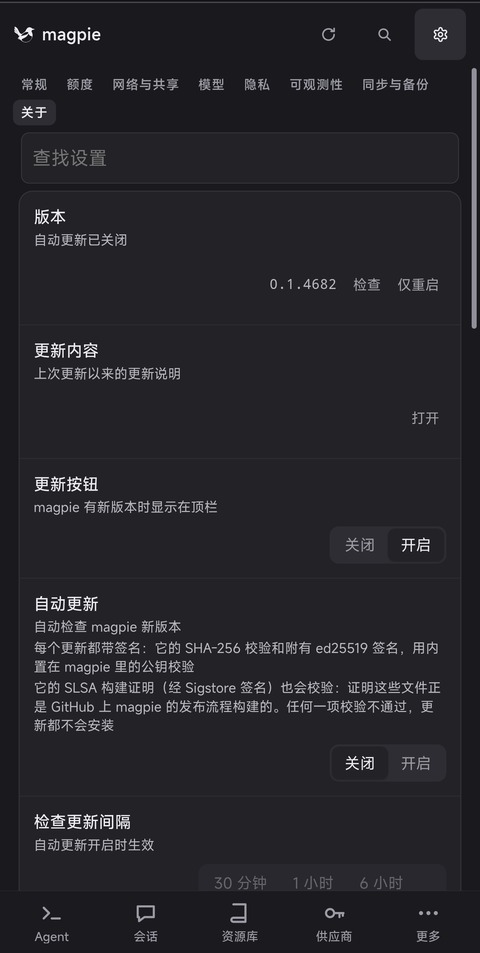
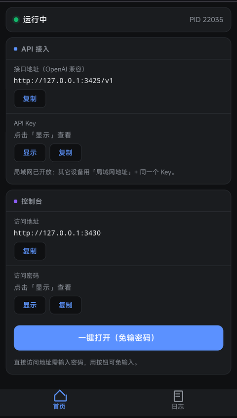
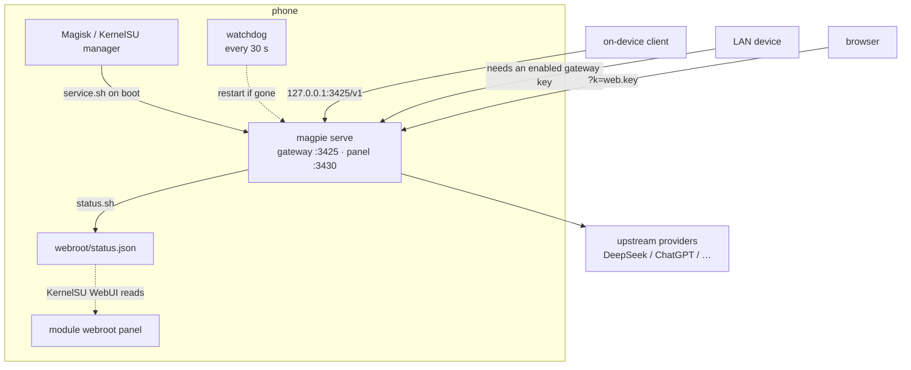

<div align="center">

# Magpie AI Gateway · Android Module

Turn [magpie](https://github.com/yetone/magpie) into a persistent Android service: starts on boot, comes back when killed, start/stop from the `[Action]` menu.

[](https://github.com/KANGKKKKKKK/magpie-magisk/releases)
[](https://github.com/KANGKKKKKKK/magpie-magisk/actions/workflows/ci.yml)
[](LICENSE)
[](https://github.com/topjohnwu/Magisk)
[](#requirements)

**English** | [简体中文](README.md)

</div>

> [!NOTE]
> This repository contains **only the module scripts**, not magpie itself (the arm64 binary).
> Not having it is fine: tap `[Action]` after flashing and the module downloads and installs it —
> the first tap only shows the plan, a second tap starts the download. The current download size
> is the manifest `size` reported by `install.sh plan`.
>
> The module only keeps magpie running on this phone. Providers, models, quotas and accounts are
> magpie's own business, not this module's.

## TL;DR

If you already know your way around Magisk modules, this is all you need; each step is explained in [Quick start](#quick-start).

1. Download `magpie-v*.zip` from [Releases](https://github.com/KANGKKKKKKK/magpie-magisk/releases) and flash it in your manager.
2. Tap the module's `[Action]`: the first tap shows the install plan, the second downloads and installs magpie (skip if you already have it).
3. Reboot so the DNS overlay applies and the service starts.
4. Add a provider in magpie's own panel, point your client at `http://127.0.0.1:3425/v1`, and send a message. A real reply means you are done.

When in doubt, run the self-check: `su -c sh /data/adb/modules/magpie/scripts/doctor.sh`.

## Contents

- [TL;DR](#tldr)
- [Why this exists](#why-this-exists)
- [What it does](#what-it-does)
- [Quick start](#quick-start)
- [Installing the body](#installing-the-body)
- [Daily use](#daily-use)
- [Connecting a client](#connecting-a-client)
- [The two different keys](#the-two-different-keys)
- [Configuration](#configuration)
- [Self-check and troubleshooting](#self-check-and-troubleshooting)
- [How it works](#how-it-works)
- [File layout](#file-layout)
- [Uninstall](#uninstall)
- [Updates](#updates)
- [Quick Settings tile (optional)](#quick-settings-tile-optional)
- [Known limitations](#known-limitations)
- [Development and tests](#development-and-tests)
- [Credits](#credits)
- [License](#license)

## Why this exists

[magpie](https://github.com/yetone/magpie) is a Go program written for the desktop. It runs on a
phone, but it hits four walls in a row:

- **DNS does not resolve.** Go finds no `/etc/resolv.conf`, falls back to `127.0.0.1:53` and
  `[::1]:53`, and the log fills with `connection refused`.
  Worse, it only hits requests on the pure Go path: providers served through Bun plugins keep
  working, so it looks like "some models work, some don't".
- **HTTPS fails outright.** Go only looks at paths like `/etc/ssl/certs/ca-certificates.crt`,
  none of which exist on Android — Android keeps certificates as
  `/system/etc/security/cacerts/<hash>.0`, one file per certificate.
- **No start on boot.** There is no systemd on Android, so after a reboot you start it by hand.
- **Killed means gone.** Cleaner apps, memory reclaimers and the system's "clean up" button can
  all kill it, and it does not come back. For any downstream client that means the exit is gone.

This module fixes the first three, uses a watchdog for the fourth, and ships a small set of tools
to see the state and clean up after itself.

## What it does

| Capability | Details |
| --- | --- |
| Start on boot | Waits for `sys.boot_completed`, never blocks boot |
| Watchdog | Checks every 30 s, restarts the process if killed; respects a manual stop |
| Volume-key menu | Tapping `[Action]` opens a menu: switch gateway, see addresses, start/stop/restart, open the panel — pick with the volume keys, no typing |
| Live status | The module row shows state and the address to use ([example](#the-action-button)) without tapping anything |
| Self-check | `scripts/doctor.sh` runs ten checks and tells you what to fix |
| CLI | `magpie` is mounted into `/system/bin` (so `su -c magpie …` works under every root solution) with `HOME`, `SSL_CERT_FILE` and `MAGPIE_BUN` filled in, and says so when DNS is not set up |
| Upstream DNS | Ships `system/etc/resolv.conf`, rewritten from `MAGPIE_DNS`; no dnsmasq, no port 53 |
| Quick Settings tile | Optional ~50 KB companion app that puts start/stop in the pull-down panel; everything works without it |
| CA bundle | Merges system roots for the Go static PIE, rebuilds when system CAs change |
| Log rotation | Rotates to `.1` past 5 MB, keeps one generation; also while the service runs |
| Config safety | A config with a shell syntax error falls back to defaults (local only) and is reported in logs, doctor and the module row instead of silently killing the service |
| Online update | The manager can pull new versions directly |
| Installs the body | No body yet? Tapping `[Action]` downloads and installs it: sha256 checked, atomic replace, no debris left on failure |
| Clean uninstall | Stops the service, kills the watchdog, removes `PATH` links and verifies; the data dir is **kept by default** so providers and keys are never wiped by accident |

## Quick start

### Requirements

- [ ] Rooted device with Magisk / KernelSU / APatch
- [ ] **arm64** (magpie's binary is an arm64 ELF; arm32 and x86_64 will not run)
- [ ] Familiar with "install from storage" in the manager
- [ ] magpie's binary: use it if you have it, or let the module install it (step 2)

> [!IMPORTANT]
> Without the binary the service will not start, but **flashing the module does not fail because of
> it**: it only warns, and the watchdog will not spin retrying. Getting the binary is [step 2](#steps).

> [!NOTE]
> The `[Action]` button comes from the manager and needs its `action.sh` support — Magisk has that
> from 27.0. On older Magisk, or a manager without the button, the module still installs and runs;
> you just start and stop it from the [CLI](#cli) instead.

### Steps

**1. Install the module**

Download the latest `magpie-v*.zip` from [Releases](https://github.com/KANGKKKKKKK/magpie-magisk/releases),
then Manager → Modules → Install from storage.

This step **does not need magpie's binary to be there yet**: if it is missing, the module says so
and finishes installing anyway.

**2. Prepare the binary**

If the binary is missing, tap `[Action]` in the manager to review the installation plan,
then tap it again to confirm the download. If a usable binary is already installed, go to step 3.

<details>
<summary>CLI alternative: check or install the binary</summary>

```sh
su -c sh /data/adb/modules/magpie/scripts/install.sh status
# Example: state=ready version=0.1.4302 path=/data/adb/magpie/bin/magpie

# Use only when installing or deliberately redeploying; --yes also permits replacing an existing binary
su -c sh /data/adb/modules/magpie/scripts/install.sh install --yes
```

</details>

Details and security notes: [Installing the body](#installing-the-body).

**3. Reboot**

The module waits for `sys.boot_completed` before starting. No need to unlock the screen.

This reboot is also what puts the DNS overlay in place (`system/etc/resolv.conf` →
`/etc/resolv.conf`, mounted by Magisk at boot). Skip it and native channels keep failing to
resolve — `[8/10]` in `doctor.sh` says so outright.

**4. Verify**

```sh
su -c sh /data/adb/modules/magpie/scripts/magpie.service status
# running (PID <pid>)

su -c sh /data/adb/modules/magpie/scripts/doctor.sh   # ten checks, says what to fix
```

The module row should now read `🟢 运行中 v0.1.4260 | 仅本机` (`| 192.168.1.5:3425` once LAN is on)
instead of the static description; the status strings themselves are Chinese.

**5. Open the panel**

Use `[Action]` → 6 to open the panel. The controller checks that the running service owns a loopback listener matching the current Web configuration before handing a credential-free address to an external browser. To query just that address:

```sh
su -c sh /data/adb/modules/magpie/scripts/magpie.service panel-url
# Example: http://127.0.0.1:3430/
```

If it returns no address, run `doctor.sh` to inspect the listener; don't enter passwords into an unconfirmed page. If the verified panel needs sign-in, follow the installed Magpie version's login flow in an ordinary browser. This is Magpie's own panel, not [the module WebUI](#two-different-panels).

> [!TIP]
> To open the panel from a computer, set `MAGPIE_WEB_ADDR` to `0.0.0.0:3430` (see
> [Configuration](#configuration)), restart the service, and use the LAN address reported by
> `doctor.sh`. **Read [the two keys](#the-two-different-keys) first.**

**6. Configure a provider and get a model reply**

In **magpie's own panel (P1)**, add or sign in to at least one provider and enable the models
you want to use. Skip this if already configured. The module does not supply accounts, models or quota.

Follow [Connecting a client](#connecting-a-client), choose the same-phone or LAN setup, copy an
actual model ID from the catalog, and send a message. **A model reply completes the setup**;
a running process or an open panel alone does not verify the upstream request.

<details>
<summary>Advanced: manually extract the module instead of installing through the manager</summary>

```sh
unzip magpie-v*.zip -d /data/adb/modules/magpie   # use the file you actually downloaded
chmod 755 /data/adb/modules/magpie/*.sh /data/adb/modules/magpie/scripts/*.sh
chmod 600 /data/adb/modules/magpie/scripts/magpie.config
```

Prepare the binary and reboot as above. Installing through the manager is recommended.

</details>

## Installing the body

When no body is present, `[Action]` stops being the volume-key menu and becomes the install entry point.
The same thing from a shell:

```sh
su -c sh /data/adb/modules/magpie/scripts/install.sh status    # detect only
su -c sh /data/adb/modules/magpie/scripts/install.sh check     # ask if a newer one exists, no download
su -c sh /data/adb/modules/magpie/scripts/install.sh plan      # say what would be installed, no download
su -c sh /data/adb/modules/magpie/scripts/install.sh install   # plan first, download on a second tap
su -c sh /data/adb/modules/magpie/scripts/install.sh install --yes   # just install
su -c sh /data/adb/modules/magpie/scripts/install.sh rollback  # go back to the backup
```

**Where it comes from.** The manifest is `https://usemagpie.ai/api/latest` — magpie's own update
endpoint, the same one `magpie update` uses. The asset is `magpie-cli-android-arm64`, the only
Android build on the release page (there is no arm32 one). Downloads prefer the vendor CDN and fall
back to GitHub.

**How it is verified.** The manifest gives `size` and `sha256`; both are checked after download and
a mismatch means discard and try the next source. `SHA256SUMS` and GitHub's API `digest` field agree
with that value. **Caveat:** that sha256 comes from the same manifest, so the trust anchor is
"usemagpie.ai over TLS" — the same assumption magpie's own updater makes. The release also ships
`SHA256SUMS.sig`, but this module has no pinned key, so it does **not** claim GPG verification.

**How it is deployed.** Verify the download and run the candidate's `--version` before switching atomically. Only a verified previous binary updates `bin/magpie.bak`. If the check at the final path or writing the install record fails, the previous binary and record are restored. A candidate that fails its preliminary check does not replace the body and is retained as `bin/magpie.rejected` when possible.

**What it does not do.** No automatic download, no checking on every boot, no automatic upgrades, no
overwriting a working body (unless you pass `install --yes`), and no touching `data/`, config,
accounts, providers, keys or listen addresses. Upgrades are the binary's own job:

```sh
su -c magpie update check   # just tell me if one is out
su -c magpie update         # download, verify, restart into it
```

> [!NOTE]
> Flashing the module does **not** download anything. The flash flow has no dependable interactive
> terminal, so `customize.sh` only detects and tells you how; the download happens when you confirm it.

> [!NOTE]
> The body installer only uses downloaders that verify certificates and keep redirects on HTTPS: `curl` on `PATH` (or the absolute path in `MAGPIE_DL`) first; without curl (stock Android has none) it uses the system Java TLS stack — `app_process` runs a downloader class straight from the bundled tile APK, **no app install needed**, certificates checked against system CAs. `MAGPIE_TLS_CA_BUNDLE` applies to curl only. There is no fallback to BusyBox wget: Magisk's build does not verify certificates. An already installed body and routine service control do not require this downloader.

> [!TIP]
> To use another source (an internal mirror, a cache):
> `MAGPIE_MANIFEST_URL=https://internal/… sh install.sh install --yes`.
> Same manifest format required. The asset name can be overridden with `MAGPIE_ASSET_KEY`.

## Daily use

### The action button

The `[Action]` button in the manager opens a **volume-key menu** — no typing, no terminal:

```
───────────  Magpie  ───────────
 状态  运行中
 网关  局域网 · 其他设备可连接
 地址  192.168.1.5
────────────────────────────────
   1  切到「仅本机」
 ▸ 2  查看接入信息
   3  重启
   4  停止
   5  启动
   6  打开面板
   7  退出
────────────────────────────────
 音量下 换一项 · 音量上 执行
 60 秒没按键就自动退出
```

**Volume down = next item, volume up = run it.** 60 seconds without a key press exits.

| Item | Does |
| --- | --- |
| 1 Switch gateway | This device only: both listeners stay on loopback. LAN API: only the API is exposed. A running service is restarted as needed, and its listeners are checked. |
| 2 Connection info | Lists configured addresses and independently observed listener state |
| 3 / 4 / 5 | Restart / stop / start |
| 6 Open panel | Opens the verified loopback panel in an external browser without credentials |
| 7 Quit | Closes the `[Action]` window and returns to the module list |

With no body installed (or one that won't run) the button is still the install entry: it prints
version, size and source first, and only a second tap downloads.

> [!TIP]
> **Sharing with a tablet over a hotspot**: `[Action]` → 1 to switch to LAN → 2 to read the
> address → paste it into magpie on the tablet. Switch back to "this device only" afterwards.

> [!WARNING]
> **LAN API** only exposes the API; the management panel stays on loopback. **This device only** configures both listeners for loopback. The default transport is HTTP: use trusted networks only, never expose it directly to the public internet. Check the observed listener result, not just the saved configuration.

The volume keys do change the media volume on the way; the menu restores the value it found on
exit. Run from a terminal the menu redraws in place (only the `▸` moves); the manager's text box
does not support cursor control, so there it draws once and appends one line per key press.

That row updates itself, so you can read the address to paste into a client without touching anything:

```
🟢 运行中 v0.1.4260 | 192.168.1.5:3425      ← running, with a usable LAN address
🟢 运行中 v0.1.4260 | 仅本机                 ← bound to 127.0.0.1 only, nothing else can reach it
🔴 已停止 | 点 [执行] 启动
```

(Those strings are Chinese because the module's default locale is Chinese; the values are what
matter.) The address refreshes itself when Wi-Fi reconnects, the hotspot toggles, or airplane mode
flips — you will not be left chasing a stale address. If your font shows emoji as boxes, set
`MAGPIE_ICON` to `0` to get `[running]` / `[stopped]` text instead.

> [!NOTE]
> No `[Action]` button in your manager (see [Requirements](#requirements))? Use the CLI below — same thing.

### Two different "panels"

There are two unrelated web pages. This README labels magpie's own panel **P1** and the module's
webroot one **P2**, so there is no left/right to get confused about:

<p align="center"> </p>

**P1**: magpie's own panel, captured on the About page (version, update switches); models,
providers, quota and keys live here.  
**P2**: the module's webroot panel. It needs KernelSU WebUI / WebUI-X as a host. It displays a credential-free snapshot and cannot navigate its host WebView to the body panel. The older capture only illustrates layout.

| | P1: magpie's own panel | P2: the module's webroot panel |
| --- | --- | --- |
| URL | `panel-url` returns a verified loopback URL without credentials; or `[Action]` → 6 | provided by the host, see next column |
| Served by | magpie itself (`serve --web=…`) | `webroot/index.html`, which needs **KernelSU WebUI** or Magisk **WebUI-X** |
| What you see | magpie's full app (Agent / Sessions / Library / Providers / Gateway / Usage / Models / Plugins / Settings) | service state and PID, API config candidates, a verified panel URL if available, and a best-effort redacted log tail |
| Plain Magisk | ✅ works; the controller verifies the address | ❌ no host, nothing renders; `webroot/status.json` is still written and readable from scripts |

### CLI

```sh
su -c magpie --version
# example: magpie 0.1.3620   ← version tracks the binary, do not treat it as fixed
```

`magpie` is wrapped by `scripts/magpie-cli.sh`, which fills in the environment variables Android
lacks. Arguments are passed through unchanged.

### Service control

```sh
su -c sh /data/adb/modules/magpie/scripts/magpie.service start
su -c sh /data/adb/modules/magpie/scripts/magpie.service stop
su -c sh /data/adb/modules/magpie/scripts/magpie.service restart
su -c sh /data/adb/modules/magpie/scripts/magpie.service status
su -c sh /data/adb/modules/magpie/scripts/doctor.sh          # ten self-checks
```

`start` returns non-zero on failure. Logs are in `/data/adb/magpie/run/magpie.log`.

## Connecting a client

### Before you start

- [ ] The service is running; use the ten-check command below if unsure.
- [ ] At least one provider is configured in **magpie's own panel (P1)** and the intended models are enabled.
- [ ] Choose the same-phone or LAN setup below. LAN calls additionally require an **enabled** gateway key.

```sh
su -c sh /data/adb/modules/magpie/scripts/doctor.sh
```

### Step 1: choose the address and key for your setup

#### On the same phone

Leave the default loopback listener enabled; no LAN sharing is needed.

| Client field | Value |
| --- | --- |
| Base URL | `http://127.0.0.1:3425/v1` |
| API key | `magpie-myapp` as a local client identifier, or your own gateway key |
| Model ID | Copy an actual `id` from `GET /v1/models`; see the next step |

Loopback does not authenticate the key. **This does not apply to LAN calls**; see
[the two keys](#the-two-different-keys).

#### From a tablet or computer on the LAN

1. Prepare an enabled gateway key in magpie, or create one with the CLI:

   ```sh
   su -c magpie gateway-key add tablet
   # Save the full key returned now; do not post it in screenshots or logs
   ```

2. Connect both devices to a Wi-Fi network that allows them to reach each other, or connect the
   other device to the phone's hotspot.
3. `[Action]` → 1 switches to LAN mode; option 2 displays the connection details.
4. Enter `http://<phone-LAN-IP>:3425/v1`, the full enabled key, and an ID from the model catalog.
   For example: `http://192.168.1.100:3425/v1`. Do not enter `127.0.0.1` or `0.0.0.0` on the other device.

> [!WARNING]
> LAN mode opens only the API, over HTTP by default. Use trusted networks only.
> The API key is not the panel password from `?k=`.

> [!NOTE]
> CLI `gateway-key list` does not provide a full plaintext key for client configuration.
> Save the full key when creating or rotating it, not its mask. If lost, run
> `magpie gateway-key rotate <id>` and update clients that use the old key.
> Values displayed by the module's status panel (P2) depend on the binary version and status
> collection; do not rely on that panel as your only backup of a full key.

### Step 2: configure the client and select an actual model ID

This example assumes standard OpenAI Base URL joining; it is not a universal client import file.

```jsonc
{
  "base_url": "http://127.0.0.1:3425/v1",  // replace the host for LAN use
  "api_key":  "magpie-myapp",             // loopback only; LAN requires an enabled gateway key
  "model":    "<id copied from /v1/models>"
}
```

- Use the client's fetch/refresh-models control, or query `GET /v1/models` as shown below.
- Ordinary IDs usually look like `deepseek/deepseek-chat`; **routing groups use their group name**.
  Copy the returned `id` exactly: do not add a provider prefix to a group or use a display name instead.
- Clients differ in URL handling. A Base URL normally includes `/v1`; if the client adds `/v1`
  itself, use the gateway root. If it asks for a full endpoint, supply the complete request URL.
  The final path must be `/v1/chat/completions` or `/v1/responses`, not a missing or doubled `/v1`.

<details>
<summary>Common Base URLs for other protocols (Anthropic / Gemini)</summary>

```text
OpenAI     http://127.0.0.1:3425/v1        # /v1/chat/completions, /v1/responses
Anthropic  http://127.0.0.1:3425           # /v1/messages
Gemini     http://127.0.0.1:3425           # /v1beta/models/{model}:generateContent
```

Replace the host for LAN use, and account for the client's URL-joining behavior.
See [magpie's integration docs](https://github.com/yetone/magpie/blob/main/docs/integrating.md)
for protocols and the model catalog.

</details>

### Step 3: verify the connection and get a reply

Fetch the model list in your client, then select a model and send `hi`. **Listing models does not
prove an upstream call works**; a real reply also checks provider access, quota and the request path.

In a terminal with `curl` 7.76+ (for example, a computer or Termux), use the POSIX Shell example below.
`BASE_URL` **includes `/v1`** and is reused for every request, so the computer never accidentally
switches back to its own loopback address.

```sh
# On the same phone:
BASE_URL='http://127.0.0.1:3425/v1'
API_KEY='magpie-myapp'

# On a tablet / computer, replace the two values instead; substitute your phone IP and full key:
# BASE_URL='http://192.168.1.100:3425/v1'
# API_KEY='<full-enabled-gateway-key>'

# 1. List actual model IDs, one per line
curl --fail-with-body -sS --connect-timeout 5 --max-time 30 \
  -H "Authorization: Bearer $API_KEY" "$BASE_URL/models?format=text"
```

Copy an ID from that result into `<model-id>` below, and continue in the same terminal.
This next request calls the upstream model and may consume quota.

```sh
# 2. Send a real message; a routing group uses its group name
curl --fail-with-body -sS --connect-timeout 5 --max-time 120 \
  "$BASE_URL/chat/completions" \
  -H "Authorization: Bearer $API_KEY" \
  -H 'Content-Type: application/json' \
  -d '{"model":"<model-id>","messages":[{"role":"user","content":"hi"}]}'
```

Without `curl` on the phone, use `doctor.sh` above to check the module, then fetch models and test
a message in the client. No extra command-line tools are required. The self-check does not replace
a real model call.

<details>
<summary>Connection troubleshooting (FAQ)</summary>

| Symptom | What to check |
| --- | --- |
| `Connection refused` | Process, port and binding address; run `doctor.sh` |
| Works on the phone, not from a computer | Confirm the API listens on the LAN and use the phone's LAN IP, not `127.0.0.1` |
| Timeout without refusal | Wi-Fi / hotspot reachability, AP isolation, firewall or a changed phone IP |
| 404 | Inspect the final request path: missing `/v1`, doubled `/v1`, or the wrong protocol / endpoint |
| API returns 401 | LAN calls need a full enabled gateway key, not a panel password, placeholder or mask |
| `model not found` | Copy the `id` again from `/v1/models`; check enabled models and key permissions |
| Model list works, messages fail | Read the error and logs; check provider sign-in, quota, upstream network and model capabilities |
| Panel returns 401 | Verify the local panel address first, then follow the installed Magpie version’s login flow. Do not use the panel password as an API key. |
| Module panel does not show the API key | It is not included in the module snapshot; use the full key saved at creation or rotation. |

</details>

## The two different keys

| | Gateway API key | Panel access password |
| --- | --- | --- |
| Looks like | `sk-...` by default; any format if you supplied `--key` | 32 hex characters |
| Stored in | `/data/adb/magpie/data/.config/magpie/caller-keys.json` (managed by the binary; do not edit or use as a key backup) | `/data/adb/magpie/data/web.key` |
| Used by | clients calling `/v1` | browsers opening the panel (`?k=` in the URL) |
| Shown in the panel as | API key | access password |
| How to get one | `magpie gateway-key add <name>`, or `add <name> --key <value>` | generated on first start, stable afterwards |
| What it decides | **who may call**, which models and accounts, how much quota | **who may see the panel** |

The `?k=` flow: the first request with the correct password returns 303 and sets a sign-in cookie;
after that the browser uses the cookie. So `?k=` is needed only once per browser.

> [!IMPORTANT]
> **Loopback requests are not authenticated.** magpie's own docs say "On this machine the gateway
> takes any key", and a request without an `Authorization` header to `/v1/models` succeeds here.
> "Has a key" is not a local security boundary — do not treat it as one.

Magpie's own panel (P1) manages providers, accounts and gateway keys, not just status. The module
panel's status JSON (P2) no longer contains keys. Its log tail is only redacted on a best-effort basis. **Do not share a full `?k=` URL or key screenshots**; inspect any logs yourself before posting.

Exposure once you open the LAN listener:

- `MAGPIE_ADDR=0.0.0.0:3425` → the gateway is reachable on the subnet. Remote callers **must present
  an enabled gateway key**; random strings are rejected. The port itself is still discoverable.
- `MAGPIE_WEB_ADDR=0.0.0.0:3430` → the panel is exposed; without `?k=` you get 401. If the password
  leaks, someone may enter the management interface and change provider or key settings.

The LAN menu changes the API to a non-loopback listener and keeps the management panel on loopback. HTTP is not encrypted: use only trusted networks and never forward these ports to the public internet.

Suggested order: **create a gateway key first, then open the LAN listener**. If you only use the
phone itself, leave the defaults at `127.0.0.1`. When unsure, run `doctor.sh` — it prints the
current exposure plainly.

## Configuration

| Variable | Default | Meaning |
| --- | --- | --- |
| `magpie_path` | `/data/adb/magpie` | Data directory: binary, logs, magpie's own data |
| `MAGPIE_ADDR` | `127.0.0.1:3425` | Gateway listen address; **must be `host:port`** |
| `MAGPIE_WEB_ADDR` | `127.0.0.1:3430` | WebUI listen address; empty means `MAGPIE_ADDR`'s host + 3430 |
| `MAGPIE_DNS` | `223.5.5.5 119.29.29.29 8.8.8.8` | Upstream DNS, space separated; written into the module's `/etc/resolv.conf` overlay, effective after a service restart |
| `MAGPIE_ICON` | `1` | Status icon in the manager: `1` = 🟢/🔴, `0` = `[running]`/`[stopped]` text |
| `MAGPIE_WATCH_INTERVAL` | `30` | Watchdog check interval in seconds; backoff on repeated start failures is derived from it (capped at 10 min) |
| `MAGPIE_DL_TIMEOUT` | `1800` | Total time limit for the binary download, in seconds |
| `MAGPIE_DL_STALL` | `60` | Stall timeout: give up after this many seconds without any data |

The default config file only lists the first five; add a line for the others when you need them,
e.g. `MAGPIE_WATCH_INTERVAL="60"`.

<details>
<summary>Advanced installer overrides (mirrors, custom curl / CA — rarely needed)</summary>

These are usually set inline for a single run:

| Variable | Default | Meaning |
| --- | --- | --- |
| `MAGPIE_CONF` | empty | Explicit config file, for diagnostics and tests |
| `MAGPIE_MANIFEST_URL` | `https://usemagpie.ai/api/latest` | Binary update manifest; point it at your mirror |
| `MAGPIE_ASSET_KEY` | `magpie-cli-android-arm64` | Which asset to take from the manifest |
| `MAGPIE_DL` | `curl` on `PATH`, else system Java TLS | Absolute path to a trusted curl |
| `MAGPIE_TLS_CA_BUNDLE` | empty | Extra PEM bundle to trust for downloads |
| `MAGPIE_CONFIRM_WINDOW` | `600` | Confirmation window between the two `[Action]` taps, in seconds |

```sh
su -c 'MAGPIE_MANIFEST_URL=https://mirror.example/latest sh /data/adb/modules/magpie/scripts/install.sh plan'
```

</details>

The scripts look for the config file in order: explicit `MAGPIE_CONF` (diagnostics / tests),
`/data/adb/magpie/scripts/magpie.config`, then the module's `scripts/magpie.config`. **Edit the one in the data directory** — the module copy is
replaced on update. If neither exists, built-in defaults apply and everything listens on
`127.0.0.1`.

The data-directory copy is **created automatically at boot** (`seed_user_config` in
`service.sh`): copied from the module only when absent, mode 600, never overwritten.
So you can edit it directly — no need to create it first.

Three hard rules for listen addresses — a bad value is rejected instead of being papered over:

- **The port is mandatory.** `MAGPIE_ADDR=127.0.0.1` (no port) makes `magpie.service start` refuse
  to start and `[Action]` say so explicitly. Older versions silently fell back to 3425, which produced
  an invalid `status.json`, a bogus `http://127.0.0.1:127.0.0.1/v1` URL, and a wrong LAN badge.
- **The port must be 1–65535 decimal.** `0`, `99999`, `0x10b1`, `03425` are all rejected.
- **IPv6 needs brackets**: `[::1]:3425`. `[::1]:3425`, `::1`, `localhost`, `127.0.0.1` all count as
  local-only and are never reported as LAN-exposed.

Invalid entries in `MAGPIE_DNS` are skipped and named in the log (`8.8.8` would be reported), while
the valid ones still take effect; only when nothing valid remains is the existing DNS left untouched.
The check is format-only: a router address such as `192.168.1.1` — or even `127.0.0.1` when the device
runs its own resolver — is allowed, and `doctor.sh` does a real lookup at runtime.

The service script, `status.sh`, `doctor.sh`, `magpie`, and the uninstaller use `magpie_path`;
the config file itself is still read from the fixed locations above. Leave `magpie_path` alone if
you only need to change listeners or DNS.

The installer writes only to `/data/adb/magpie` and its descendants and refuses symlinks. For old installations using `/data/adb/modules/magpie`, `install.sh status` can still inspect the existing binary. Before installing, rolling back, updating the module or removing it, back up and move the data outside the module tree. Other unsupported legacy paths require stopping via `magpie.service` before migration. Nothing is moved automatically.

Restart to apply:

```sh
su -c sh /data/adb/modules/magpie/scripts/magpie.service restart
```

## Self-check and troubleshooting

`scripts/doctor.sh` runs ten read-only checks:

```
[1/10] binary and process    installed? runs? version? PID? oom_score_adj?
[2/10] listeners             verified socket ownership and bind scope
[3/10] local reachability    does the gateway answer 200
[4/10] panel and password    is the password file present (never read or sent)
[5/10] gateway keys          how many are enabled
[6/10] CA bundle             certificate count and permissions
[7/10] LAN exposure          configured targets versus observed API / Web listeners
[8/10] DNS                   is /etc/resolv.conf there, can the upstream resolve
[9/10] quick tile            installed? root grant? what it paints, matches reality? frozen?
[10/10] logs and storage     log sizes, data dir writable, free space
```

The tile check passes when the app is not installed or not added to Quick Settings — it
is optional. "Paints something different from reality" is only a hint, not a failure:
the tile re-reads state when the panel opens, so a service restarted from the CLI or
by the watchdog legitimately leaves a stale label. What matters is "process is frozen";
the script then names the likely freezer (NoActive / CZero / system
`cached_apps_freezer` / vendor greezer) and tells you to whitelist the app's UID there.

| Symptom | Fix |
| --- | --- |
| Says the body is not installed | Expected state, not a fault. See [Installing the body](#installing-the-body) |
| Install: cannot fetch the manifest | No network, or the endpoint is blocked. Try `install.sh check`; use `MAGPIE_MANIFEST_URL` for another source |
| Install: sha256 mismatch | Something rewrote or truncated the download. Retry on another network; if it persists, do not install — check the release page |
| Install: runs, then fails the self-check | Preflight failure leaves the candidate at `bin/magpie.rejected` when possible; failure at the final path restores the exact previous state |
| Want the previous body back | `install.sh rollback` |
| Start fails, log says port in use | Identify the listener with `doctor.sh` or `ss -ltnp`; use `restart` if it is this service. Do not kill all `pidof magpie` results: MCP children may share that name |
| Panel data never changes | Check "数据 HH:MM:SS": normal polling refreshes about every 2.5 min by default; custom intervals or failed-start backoff can delay it. If stale for a long time, check the watchdog process and startup/error entries in `run/watchdog.log`; it does not log every round |
| HTTPS fails with certificate errors | Delete `/data/adb/magpie/data/certs/ca-bundle.crt*` and restart; it rebuilds |
| Native channels throw `lookup ... on [::1]:53: connection refused` | Go has no upstream. `cat /etc/resolv.conf`; if it is missing, reboot once so the overlay applies, then check `[8/10]` in doctor |
| Process returns after being killed | The watchdog revives unexpected exits. Stop through the menu, tile or `magpie.service stop` instead; `.user_stopped` prevents watchdog restarts during this boot |
| Edited `magpie.config` but nothing changed | Make sure you edited `/data/adb/magpie/scripts/magpie.config`, then `restart` |
| Doctor says the config has a syntax error | Usually an unbalanced quote. `sh -n /data/adb/magpie/scripts/magpie.config` points at the line; until fixed the service runs on defaults (local only) |
| Installer says there is no certificate-verifying HTTPS downloader | The module zip is incomplete (no `magpie-tile.apk`) or `app_process` is missing. Reflash the full zip, or install curl and set `MAGPIE_DL` |
| No start on boot | Confirm the module is enabled; read startup errors in `run/watchdog.log` and run `doctor.sh`. A boot-ID marker from the previous boot does not block startup. An unversioned legacy marker is conservative and can be cleared by explicit `start`. |

More detail in [CHANGELOG.md](CHANGELOG.md).

### Reporting a problem

- Module issues (won't start, binary won't install, menu or tile misbehaves): open an [issue](https://github.com/KANGKKKKKKK/magpie-magisk/issues/new/choose) and include the full `doctor.sh` output, the module version, your manager and its version, device model and Android version.
- Providers, models, quota, accounts or panel features belong to magpie itself: report them [upstream](https://github.com/yetone/magpie/issues).
- Check logs and screenshots before posting: no gateway keys, panel passwords or `?k=` links.

## How it works



<details>
<summary>What each entry script does</summary>

- **`service.sh`** — waits for `sys.boot_completed=1`, rotates logs, starts the service, refreshes
  status. Also runs a 30 s watchdog that restarts the process if it is gone, and refreshes the LAN
  address when it changes. Exits on its own if the module is disabled, being uninstalled, or deleted.
- **`action.sh`** — the `[Action]` menu. Pick with the volume keys (switch gateway / show
  addresses / start / stop / restart / open panel / quit); also accepts `status`, `gateway`,
  `lan`, `local`, `start`, `stop`, `restart`, `panel`. Falls back to the old one-tap toggle when
  the volume keys cannot be read. Refreshes the module description after every action.
- **`scripts/magpie.service`** — the real control script. Cleans up legacy dnsmasq from v0.2,
  injects environment variables, launches `magpie serve --web=<addr>`, writes the PID and panel URL.

</details>

<details>
<summary>Three design decisions: DNS, CA bundle, LAN address</summary>

- **DNS comes from a module-provided `/etc/resolv.conf`.** magpie is a Go static PIE that links no libc, so it can
  only use the pure Go resolver, which reads that one file. Android has no such file: Go then falls
  back to `127.0.0.1:53` / `[::1]:53`, where nothing listens, and every native channel dies with
  `connection refused`. The module ships `system/etc/resolv.conf`, Magisk overlays it onto
  `/etc/resolv.conf`, and its contents are rewritten from `MAGPIE_DNS`. No local dnsmasq, so it never
  fights the system's tethering dnsmasq for port 53 (a real bug in v0.2).
  Also a correction: `DNS_LOCAL_HOSTNAMES` is not a Go variable and does not appear in the binary —
  what v0.9.0 and earlier exported never took effect.
- **The CA bundle updates itself.** It fingerprints the system certificate directories (file count
  + directory mtime, over both `/system/etc/security/cacerts` and the APEX copy), stores that in
  `ca-bundle.crt.stamp`, and rebuilds when it differs. Rebuilds write a temp file and swap
  atomically only after verifying certificates are inside; failures keep the old bundle.

  The trust set is exactly the system's own roots: nothing extra installed, no MITM, no disabled
  verification.
- **The LAN address is chosen carefully.** Wi-Fi / hotspot / USB first, skipping cellular
  interfaces. Loopback, link-local, mihomo's fake-ip range (198.18.0.0/15) and carrier-grade NAT
  (100.64.0.0/10) are excluded — the last two would advertise an address nothing can reach.

</details>

## File layout

```
magpie-magisk/
├── module.prop                       module metadata (name, version, description, updateJson)
├── customize.sh                      runs at flash time: permissions, binary check
├── service.sh                        boot start + watchdog
├── action.sh                         the manager's [Action] button
├── uninstall.sh                      cleanup on removal
├── system/bin/magpie                 command entry, mounted into /system/bin (hands off to scripts/magpie-cli.sh)
├── system/etc/resolv.conf            DNS overlay: upstream for the Go static PIE (from MAGPIE_DNS)
├── update.json                       manifest for online updates
├── build.sh                          build the flashable zip
├── scripts/
│   ├── magpie.service                start / stop / restart / status
│   ├── status.sh                     manager description, status.json, log tail
│   ├── install.sh                    detect / download / verify / deploy the body
│   ├── lib.sh                        LAN address, process and body helpers, shared
│   ├── doctor.sh                     ten self-checks
│   ├── magpie-cli.sh                 environment wrapper around the binary
│   ├── tile-app.sh                   tile app install / version check (flash and boot)
│   ├── tile-check.sh                 tile health check (shared by the app and doctor [9/10])
│   ├── ci/                           release helpers: version gate, zip verification, release flow
│   └── magpie.config                 configuration defaults
├── tile-app/                         tile app source (optional, bundled into the zip at build time)
├── tests/
│   ├── run-all.sh                    full suite, shared by CI and release
│   ├── test-*.sh / test-*.py         shell suites and Python unittests
│   ├── jvm/                          JVM tests for the tile logic (no Android needed)
│   ├── check-counts.sh               runs the suites and checks the counts quoted in the docs
│   └── make-fixtures.py              installer fixtures (--base sets the manifest host)
├── webroot/
│   └── index.html                    the module panel (needs KernelSU WebUI / WebUI-X)
├── docs/
│   ├── release-policy.md             release policy: protected environments, signing, update PR
│   ├── panel.png                     P2 screenshot (the module panel)
│   ├── panel-magpie.jpg              P1 screenshot (magpie's own panel)
│   └── social-preview.png            the repo's social preview image (1280×640)
├── .github/workflows/
│   ├── ci.yml                        on every push / PR: syntax checks + all suites
│   └── release.yml                   tag → build → release → update.json PR
└── META-INF/com/google/android/      Magisk flash scripts
```

Generated at runtime, never committed:

```
/data/adb/magpie/run/magpie.log        service log
/data/adb/magpie/run/watchdog.log      watchdog log
/data/adb/magpie/run/lan.url           LAN address (when exposed)
/data/adb/magpie/run/.user_stopped     marker for a manual stop
/data/adb/magpie/run/magpie.pid        PID file
/data/adb/magpie/run/resolv.conf       DNS config currently in effect (for reference)
/data/adb/magpie/install-info.txt      install record (version, source, digest; mode 600)
/data/adb/magpie/bin/magpie.bak        previous body, for rollback
/data/adb/magpie/.install.flock        install mutex (do not delete while running)
/data/adb/magpie/run/*.flock           lifecycle / stop-intent mutexes (same)
/data/adb/magpie/bin/magpie.rejected   candidate binary that failed preflight (only if any)
/data/adb/magpie/.install.pending      second-tap confirmation marker
/data/adb/magpie/data/certs/           CA bundle and its fingerprint
webroot/status.json                    credential-free panel data (mode 600)
webroot/lastlog.txt                    best-effort redacted panel log tail (mode 600)
```

## Uninstall

Remove the module in the manager, or:

```sh
su -c sh /data/adb/modules/magpie/uninstall.sh
```

The uninstall script writes a maintenance marker and stops the service first. It aborts cleanup if stopping fails or verified service processes remain. It does not delete the persistent data root: the binary, settings, providers, keys, usage records, and logs are retained by default. Back up and double-check the path before deleting any of them manually.

> [!WARNING]
> Earlier versions allowed `magpie_path` inside the module directory. **Back up and move such data to `/data/adb/magpie` before removing or updating the module.** The manager may delete its entire module tree and may ignore the script's exit code; the script does not migrate the data for you.

Once you are sure you no longer need it, have a backup, and the module is gone after a reboot,
delete the data directory by hand:

```sh
su -c ls /data/adb/magpie            # look first: is this the directory you mean?
su -c rm -rf /data/adb/magpie        # irreversible: binary, providers, keys and usage records
```

Use your own path if you changed `magpie_path`.

## Updates

`module.prop` carries an `updateJson` pointing at [`update.json`](update.json) in this repository.

- The manager compares `versionCode` and offers an update when a new release exists.
- The binary updates independently: use `su -c magpie update`; no need to reflash the module.
- Releases are built by GitHub Actions: push a `v*` tag and the workflow packs the zip, verifies
  its source and signatures, publishes the release and proposes an `update.json` PR. The manager
  only sees the update once that PR is merged into `main`.
- Updating the module **does not** touch `/data/adb/magpie`, so providers, keys and logs survive.

## Quick Settings tile (optional)

While flashing, the volume keys let you install a small companion app that puts Magpie's
start/stop into the pull-down Quick Settings panel:

```
  Optional companion app
- Magpie tile: start/stop from Quick Settings
  It is not magpie and proxies nothing; it is just a switch that
  calls this module's control script through root. Skipping it changes nothing.

  Volume up = install, volume down = skip (skips after 15 s)
```

(The real prompt is in Chinese.) Two more steps after installing:

1. Open the app and tap "grant root" once. The tile runs in the background and cannot show the
   root prompt itself.
2. Pull down Quick Settings → edit → drag **Magpie** into place. Android does not let apps add tiles
   on their own.

The tile shows running / stopped and toggles on tap. Stopping goes through the same `stop` path and
writes `.user_stopped`, so the watchdog does not bring back a service you stopped on purpose.
**Long-press the tile** to open the app's settings; the "launcher icon" switch there hides the app
icon, and long-pressing the tile is how you get back to restore it.

Implementation, fallback commands and build notes: [tile-app/README.md](tile-app/README.md).

## Known limitations

- The installer supports **arm64 only**: the release page has no arm32 / x86_64 Android build, so
  other architectures are refused outright instead of getting a wrong binary.
- The installer defaults to first installation. Without `--yes`, it will not replace a usable
  existing binary. Explicit `install --yes` redeploys from the current manifest; use `magpie update`
  for routine upgrades.
- Digests come from usemagpie.ai's manifest; no GPG verification is done. See
  [Installing the body](#installing-the-body).
- The webroot panel is **not live monitoring**. It re-reads `status.json` every 5 s, but that file is
  rewritten on events (start/stop, gateway switch, LAN address change) plus once every 5 watchdog
  rounds (~2.5 min). Uptime and memory can lag by a couple of minutes; the "数据 HH:MM:SS" in the
  status bar is when the file was last written. For the current instantaneous view use `doctor.sh`.
- magpie itself is not bundled; its own updates are its business.
- KernelSU / APatch paths are covered in the scripts (`ksud`, `/data/adb/ap/bin`, `/data/adb/ksud`)
  but **only Magisk 31.1 has been tested here**.
- Tested on arm64 + Android 14 (HyperOS 2.0); theoretically any arm64 device on Android 10+.
- Legacy dnsmasq cleanup targets only old processes with `listen-address=::1`; the system's
  tethering dnsmasq is never touched.
- **The DNS overlay needs one reboot**: `system/etc/resolv.conf` is mounted by Magisk at boot, so
  installing or updating the module needs a reboot. Afterwards a service restart rewrites the
  overlay; if doctor still shows the old upstream, reboot once more.
- **A tile Shell timeout is not confirmed cancellation of root descendants**: toggle is never automatically replayed, and incomplete/timeout results stay unknown. Root-side cancellation still needs isolated testing across Magisk/KernelSU/APatch; destroying the client Process does not prove the whole root task ended.
- **Conservative stop intent across versions**: boot and watchdog use `auto-start`, which respects the current boot's manual stop under the lifecycle lock. A legacy empty marker or an unreadable boot ID is conservative until an explicit start. Update the tile and controller together: a new tile never falls back to unconditional `toggle` on an older controller; stale/unknown results only trigger a read.
- **Tiles and custom data paths**: start/stop and panel lookup both use the module controller and its current configuration. The launcher-hidden marker still uses `/data/adb/magpie/run/.tile_launcher_hidden`. If root manager or SELinux access prevents socket ownership checks, the listener shows as unknown and the tile does not open the panel automatically.

## Development and tests

One command covers everything, and it is what CI and the release workflow run:

```sh
sh tests/run-all.sh   # syntax checks + shellcheck + count check + JVM tests + all suites
```

It needs `python3` (fixture server), `javac`/`java` (JVM tests) and `shellcheck`, and runs entirely
in temp directories. To run a single suite:

```sh
python3 tests/make-fixtures.py /tmp/fx          # fixtures: fake binary + manifest variants
(cd /tmp/fx && python3 -m http.server 8899) &   # serve them
TEST_SRV=http://127.0.0.1:8899 sh tests/test-install.sh   # installer, 80 assertions
sh tests/test-watchdog.sh                                 # watchdog, 17 assertions
TEST_SRV=http://127.0.0.1:8899 sh tests/test-action.sh    # [Action] menu, 56 assertions
sh tests/test-service.sh                                  # lifecycle, process identity, stop results: 190 assertions
sh tests/test-lib.sh                                      # pure helpers and process identity: 275 assertions
sh tests/test-tile-check.sh                               # self-check data, unknown results and large dumps: 122 assertions
```

740 assertions total (80 + 17 + 56 + 190 + 275 + 122), plus 446 JVM cases in `tests/jvm/` (21 classification, 28 request ordering, 361 self-check, 16 Shell process and URL checks, 8 serial-executor assertions, 12 HTTPS downloader). Tests use temp
directories and stubbed process checks — a running service is never touched. These counts describe
the suites; they do not mean every test has been run on a real device. When using a different port, generate the fixtures with the same base
(`make-fixtures.py /tmp/fx --base http://127.0.0.1:18999`), otherwise the manifest points at the
wrong port and you get a pile of fake failures. Details and known gaps in
[tests/README.md](tests/README.md).

`run-all.sh` also runs 106 Python unittests: 34 release/build, 9 tile-version gate, 18 tile lifecycle, 3 launcher, 25 doctor-tile, 11 release policy and 6 installer TLS. Lifecycle cases use SDK 29/35 in-memory stubs; they are not real Android-device tests.

Before releasing, configure the [release policy](docs/release-policy.md): protected environments, a policy commit SHA, immutable releases and tag rules. Bump the module and tile independently where appropriate, wait for CI on that exact `main` commit, then push the matching annotated tag. Building without release secrets, signing, public release and proposing the manager update are separate jobs. The update becomes visible only when its PR is merged into `main`. A dispatch on `main` verifies an existing draft or release; it does not create a new tag attestation.

The social preview image lives at `docs/social-preview.png` (1280×640). GitHub has no API for it —
upload it by hand under Settings → Social preview.

## Credits

- [DeepSeek](https://github.com/deepseek-ai) — script cleanup and documentation were written with
  DeepSeek model assistance.
- [magpie](https://github.com/yetone/magpie) — the thing this module serves. MIT licensed,
  homepage [usemagpie.ai](https://usemagpie.ai).

## License

Module scripts are released under [MIT](LICENSE). magpie itself is not in this repository; it is
[third-party software](https://github.com/yetone/magpie) owned by its author.

Know your recovery options before flashing anything.
