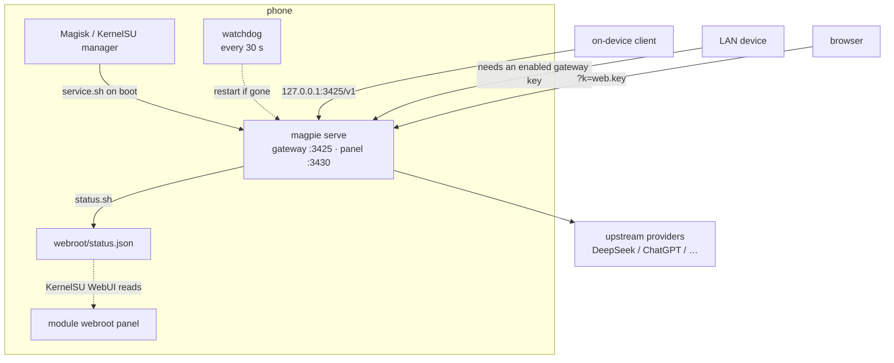

<div align="center">

# Magpie AI Gateway · Android Module

Turn [magpie](https://github.com/yetone/magpie) into a persistent Android service: starts on boot, comes back when killed, start/stop from the `[Action]` menu.

[](https://github.com/KANGKKKKKKK/magpie-magisk/releases)
[](LICENSE)
[](https://github.com/topjohnwu/Magisk)
[](#requirements)

**English** | [简体中文](README.md)

</div>

> [!NOTE]
> This repository contains **only the module scripts**, not magpie itself (the arm64 binary is ~87 MB).
> Not having it is fine: tap `[Action]` after flashing and the module downloads and installs it —
> the first tap only shows the plan, a second tap starts the download.
>
> The module only keeps magpie running on this phone. Providers, models, quotas and accounts are
> magpie's own business, not this module's.

## Contents

- [Why this exists](#why-this-exists)
- [What it does](#what-it-does)
- [Quick start](#quick-start)
- [Installing the body](#installing-the-body)
- [Daily use](#daily-use)
- [Connecting a client](#connecting-a-client)
- [The two different keys](#the-two-different-keys)
- [Configuration](#configuration)
- [Self-check and troubleshooting](#self-check-and-troubleshooting)
- [How it works](#how-it-works)
- [File layout](#file-layout)
- [Uninstall](#uninstall)
- [Updates](#updates)
- [Known limitations](#known-limitations)
- [Development and tests](#development-and-tests)
- [Credits](#credits)

## Why this exists

[magpie](https://github.com/yetone/magpie) is a Go program written for the desktop. It runs on a
phone, but it hits four walls in a row:

- **DNS does not resolve.** Go finds no `/etc/resolv.conf`, falls back to `127.0.0.1:53` and
  `[::1]:53`, and the log fills with `connection refused`.
  Worse, it only hits requests on the pure Go path: providers served through Bun plugins keep
  working, so it looks like "some models work, some don't".
- **HTTPS fails outright.** Go only looks at paths like `/etc/ssl/certs/ca-certificates.crt`,
  none of which exist on Android — Android keeps certificates as
  `/system/etc/security/cacerts/<hash>.0`, one file per certificate.
- **No start on boot.** There is no systemd on Android, so after a reboot you start it by hand.
- **Killed means gone.** Cleaner apps, memory reclaimers and the system's "clean up" button can
  all kill it, and it does not come back. For any downstream client that means the exit is gone.

This module fixes the first three, uses a watchdog for the fourth, and ships a small set of tools
to see the state and clean up after itself.

## What it does

| Capability | Details |
| --- | --- |
| Start on boot | Waits for `sys.boot_completed`, never blocks boot |
| Watchdog | Checks every 30 s, restarts the process if killed; respects a manual stop |
| Volume-key menu | Tapping `[Action]` opens a menu: switch gateway, see addresses, start/stop/restart, open the panel — pick with the volume keys, no typing |
| Live status | The module row shows state and the address to use ([example](#the-action-button)) without tapping anything |
| Self-check | `scripts/doctor.sh` runs nine checks and tells you what to fix |
| CLI | `magpie` lands on `PATH` with `HOME`, `SSL_CERT_FILE` and `MAGPIE_BUN` filled in, and says so when DNS is not set up |
| Upstream DNS | Ships `system/etc/resolv.conf`, rewritten from `MAGPIE_DNS`; no dnsmasq, no port 53 |
| CA bundle | Merges system roots for the Go static PIE, rebuilds when system CAs change |
| Log rotation | Rotates to `.1` past 5 MB, keeps one generation |
| Online update | The manager can pull new versions directly |
| Installs the body | No body yet? Tapping `[Action]` downloads and installs it: sha256 checked, atomic replace, no debris left on failure |
| Clean uninstall | Stops the service, kills the watchdog, removes `PATH` links, deletes the data dir, then verifies |

## Quick start

### Requirements

- [ ] Rooted device with Magisk / KernelSU / APatch
- [ ] **arm64** (magpie's binary is an arm64 ELF; arm32 and x86_64 will not run)
- [ ] Familiar with "install from storage" in the manager
- [ ] magpie's binary: use it if you have it, or let the module install it (step 2)

> [!IMPORTANT]
> Without the binary the service will not start, but **flashing the module does not fail because of
> it**: it only warns, and the watchdog will not spin retrying. Getting the binary is [step 2](#steps).

> [!NOTE]
> The `[Action]` button comes from the manager and needs its `action.sh` support — Magisk has that
> from 27.0. On older Magisk, or a manager without the button, the module still installs and runs;
> you just start and stop it from the [CLI](#cli) instead.

### Steps

**1. Install the module**

Download the latest `magpie-v*.zip` from [Releases](https://github.com/KANGKKKKKKK/magpie-magisk/releases),
then Manager → Modules → Install from storage.

This step **does not need magpie's binary to be there yet**: if it is missing, the module says so
and finishes installing anyway.

**2. Get the binary there (either way)**

`/data/adb/modules/magpie/` only exists once the module is flashed, so both routes live here.

Already have it — just check:

```sh
su -c sh /data/adb/modules/magpie/scripts/install.sh status
# state=ready version=0.1.4302 path=/data/adb/magpie/bin/magpie
```

Don't have it — let the module fetch and install it:

```sh
su -c sh /data/adb/modules/magpie/scripts/install.sh install --yes
```

Rather not type commands: tap `[Action]` in the manager — it runs the same flow.
Details and the security notes are in [Installing the body](#installing-the-body).

**3. Reboot**

The module waits for `sys.boot_completed` before starting. No need to unlock the screen.

This reboot is also what puts the DNS overlay in place (`system/etc/resolv.conf` →
`/etc/resolv.conf`, mounted by Magisk at boot). Skip it and native channels keep failing to
resolve — `[8/9]` in `doctor.sh` says so outright.

**4. Verify**

```sh
su -c sh /data/adb/modules/magpie/scripts/magpie.service status
# running (PID <pid>)

su -c sh /data/adb/modules/magpie/scripts/doctor.sh   # nine checks, says what to fix
```

The module row should now read `🟢 运行中 v0.1.4260 | 仅本机` (`| 192.168.1.5:3425` once LAN is on)
instead of the static description; the status strings themselves are Chinese.

**5. Open the panel**

Tap `[Action]` → 6 to open the panel in a browser, with the key already in the URL. Or read the
panel URL yourself:

```sh
su -c cat /data/adb/magpie/run/web.url
# http://127.0.0.1:3430/?k=<32-char access password>
```

Paste that into the phone's browser. That is magpie's own panel — see
[the two panels](#two-different-panels) before mixing it up with the module's.

> [!TIP]
> To open the panel from a computer, set `MAGPIE_WEB_ADDR` to `0.0.0.0:3430` (see
> [Configuration](#configuration)), restart the service, and use the LAN address reported by
> `doctor.sh`. **Read [the two keys](#the-two-different-keys) first.**

Manual install (without the zip):

```sh
unzip magpie-v*.zip -d /data/adb/modules/magpie   # use the file you actually downloaded
chmod 755 /data/adb/modules/magpie/*.sh /data/adb/modules/magpie/scripts/*.sh
chmod 600 /data/adb/modules/magpie/scripts/magpie.config
```

## Installing the body

When no body is present, `[Action]` stops being the volume-key menu and becomes the install entry point.
The same thing from a shell:

```sh
su -c sh /data/adb/modules/magpie/scripts/install.sh status    # detect only
su -c sh /data/adb/modules/magpie/scripts/install.sh check     # ask if a newer one exists, no download
su -c sh /data/adb/modules/magpie/scripts/install.sh plan      # say what would be installed, no download
su -c sh /data/adb/modules/magpie/scripts/install.sh install   # plan first, download on a second tap
su -c sh /data/adb/modules/magpie/scripts/install.sh install --yes   # just install
su -c sh /data/adb/modules/magpie/scripts/install.sh rollback  # go back to the backup
```

**Where it comes from.** The manifest is `https://usemagpie.ai/api/latest` — magpie's own update
endpoint, the same one `magpie update` uses. The asset is `magpie-cli-android-arm64`, the only
Android build on the release page (there is no arm32 one). Downloads prefer the vendor CDN and fall
back to GitHub.

**How it is verified.** The manifest gives `size` and `sha256`; both are checked after download and
a mismatch means discard and try the next source. `SHA256SUMS` and GitHub's API `digest` field agree
with that value. **Caveat:** that sha256 comes from the same manifest, so the trust anchor is
"usemagpie.ai over TLS" — the same assumption magpie's own updater makes. The release also ships
`SHA256SUMS.sig`, but this module has no pinned key, so it does **not** claim GPG verification.

**How it is deployed.** Download to a temp file on the same filesystem → verify → atomic `mv`
(never a half-written binary); the previous body is backed up to `bin/magpie.bak` first. A
`--version` self-check runs right after install: if it fails, roll back; on a first install with no
backup the sample is moved to `bin/magpie.rejected` with its sha256 printed, and nothing that "looks
installed" is left at the real path.

**What it does not do.** No automatic download, no checking on every boot, no automatic upgrades, no
overwriting a working body (unless you pass `install --yes`), and no touching `data/`, config,
accounts, providers, keys or listen addresses. Upgrades are the binary's own job:

```sh
su -c magpie update check   # just tell me if one is out
su -c magpie update         # download, verify, restart into it
```

> [!NOTE]
> Flashing the module does **not** download anything. The flash flow has no dependable interactive
> terminal and 87 MB is a lot, so `customize.sh` only detects and tells you how; the download
> happens when you confirm it.

> [!NOTE]
> The installer does not assume `wget` is on `PATH`. Module scripts started by the manager often
> get a system-only `PATH` with no `wget` in it; the installer prepends each root solution's bin
> directory and falls back to busybox's own `wget` when needed. Set `MAGPIE_DL=/path/to/curl` to
> force another downloader.

> [!TIP]
> To use another source (an internal mirror, a cache):
> `MAGPIE_MANIFEST_URL=https://internal/… sh install.sh install --yes`.
> Same manifest format required. The asset name can be overridden with `MAGPIE_ASSET_KEY`.

## Daily use

### The action button

The `[Action]` button in the manager opens a **volume-key menu** — no typing, no terminal:

```
───────────  Magpie  ───────────
 状态  运行中
 网关  局域网 · 其他设备可连接
 地址  192.168.1.5
────────────────────────────────
   1  切到「仅本机」
 ▸ 2  查看接入信息
   3  重启
   4  停止
   5  启动
   6  打开面板
   7  退出
────────────────────────────────
 音量下 换一项 · 音量上 执行
 60 秒没按键就自动退出
```

**Volume down = next item, volume up = run it.** 60 seconds without a key press exits.

| Item | Does |
| --- | --- |
| 1 Switch gateway | Toggles between `127.0.0.1` (this device only) and `0.0.0.0` (LAN); restarts the service so it takes effect |
| 2 Connection info | Lists the local and LAN addresses, plus what to paste into another device |
| 3 / 4 / 5 | Restart / stop / start |
| 6 Open panel | Opens the WebUI in a browser, with your key |
| 7 Quit | Closes the `[Action]` window and returns to the module list |

With no body installed (or one that won't run) the button is still the install entry: it prints
version, size and source first, and only a second tap downloads.

> [!TIP]
> **Sharing with a tablet over a hotspot**: `[Action]` → 1 to switch to LAN → 2 to read the
> address → paste it into magpie on the tablet. Switch back to "this device only" afterwards.

The volume keys do change the media volume on the way; the menu restores the value it found on
exit. Run from a terminal the menu redraws in place (only the `▸` moves); the manager's text box
does not support cursor control, so there it draws once and appends one line per key press.

That row updates itself, so you can read the address to paste into a client without touching anything:

```
🟢 运行中 v0.1.4260 | 192.168.1.5:3425      ← running, with a usable LAN address
🟢 运行中 v0.1.4260 | 仅本机                 ← bound to 127.0.0.1 only, nothing else can reach it
🔴 已停止 | 点 [执行] 启动
```

(Those strings are Chinese because the module's default locale is Chinese; the values are what
matter.) The address refreshes itself when Wi-Fi reconnects, the hotspot toggles, or airplane mode
flips — you will not be left chasing a stale address. If your font shows emoji as boxes, set
`MAGPIE_ICON` to `0` to get `[running]` / `[stopped]` text instead.

> [!NOTE]
> No `[Action]` button in your manager (see [Requirements](#requirements))? Use the CLI below — same thing.

### Two different "panels"

There are two unrelated web pages. This README labels magpie's own panel **P1** and the module's
webroot one **P2**, so there is no left/right to get confused about:

<p align="center"> </p>

**P1**: magpie's own panel, captured on the About page (version, update switches); models,
providers, quota and keys live here.  
**P2**: the module's webroot panel. It needs KernelSU WebUI / WebUI-X as a host; the API key
and access password are collapsed behind a "show" button and are not in the capture.

| | P1: magpie's own panel | P2: the module's webroot panel |
| --- | --- | --- |
| URL | `http://<host>:3430/?k=<data/web.key>`; or `[Action]` → 6 | provided by the host, see next column |
| Served by | magpie itself (`serve --web=…`) | `webroot/index.html`, which needs **KernelSU WebUI** or Magisk **WebUI-X** |
| What you see | magpie's full app (Agent / Sessions / Library / Providers / Gateway / Usage / Models / Plugins / Settings) | service state and PID, gateway URL and API key, panel URL and password, log tail |
| Plain Magisk | ✅ works; URL comes from `run/web.url` | ❌ no host, nothing renders; `webroot/status.json` is still written and readable from scripts |

### CLI

```sh
su -c magpie --version
# example: magpie 0.1.3620   ← version tracks the binary, do not treat it as fixed
```

`magpie` is wrapped by `scripts/magpie-cli.sh`, which fills in the environment variables Android
lacks. Arguments are passed through unchanged.

### Service control

```sh
su -c sh /data/adb/modules/magpie/scripts/magpie.service start
su -c sh /data/adb/modules/magpie/scripts/magpie.service stop
su -c sh /data/adb/modules/magpie/scripts/magpie.service restart
su -c sh /data/adb/modules/magpie/scripts/magpie.service status
su -c sh /data/adb/modules/magpie/scripts/doctor.sh          # nine self-checks
```

`start` returns non-zero on failure. Logs are in `/data/adb/magpie/run/magpie.log`.

## Connecting a client

### Before you start

- [ ] The service is running: `su -c sh /data/adb/modules/magpie/scripts/magpie.service status`
- [ ] At least one **provider configured and enabled** in magpie (a gateway key alone does not conjure models)
- [ ] An **enabled** gateway key
- [ ] Same phone → use `127.0.0.1`; another device → open the LAN listener and make sure both are on the same subnet

```sh
# One command checks all of it: binary, process, ports, keys, exposure
su -c sh /data/adb/modules/magpie/scripts/doctor.sh
```

### Step 1: get the URL and key

```sh
su -c magpie gateway-key add phone
# sk-...      ← printed once, save it now
```

The panel home page shows the same two values. What you need:

| Field | Value |
| --- | --- |
| Base URL | `http://127.0.0.1:3425/v1` |
| API key | the key printed above |

> [!WARNING]
> `gateway-key list` does **not** show full keys, only IDs and masks. Keys are printed only by
> `add` and `rotate`. Lost it? `magpie gateway-key rotate <id>` issues a new one.

### Step 2: put it in your client

Any client that accepts a custom OpenAI endpoint will work. Three fields, typically:

```jsonc
{
  "base_url": "http://127.0.0.1:3425/v1",   // required; the trailing /v1 matters
  "api_key":  "sk-...",                     // required; from step 1
  "model":    "<provider>/<model>"          // required; provider prefix included
}
```

- Models are named `<provider>/<model>`: the provider name you set up in magpie, then its model id.
  A provider called `deepseek` with model id `deepseek-chat` is `deepseek/deepseek-chat`
  (illustrative; use what your own device reports).
- To see what exists, run `magpie providers`, or ask the gateway: `GET /v1/models` — add
  `?format=text` for one id per line.
- On another device, replace `127.0.0.1` with the phone's LAN address (`doctor.sh` reports it),
  e.g. `http://192.168.1.100:3425/v1`.

<details>
<summary>Base URLs for other protocols (Anthropic / Gemini)</summary>

```text
OpenAI     http://127.0.0.1:3425/v1        # /v1/chat/completions, /v1/responses
Anthropic  http://127.0.0.1:3425           # /v1/messages
Gemini     http://127.0.0.1:3425           # /v1beta/models/{model}:generateContent
```

magpie translates between protocols. Details in
[magpie's integration docs](https://github.com/yetone/magpie/blob/main/docs/integrating.md).

</details>

### Step 3: verify the connection

**On the phone** (no `curl` there; use busybox `wget`):

```sh
wget -q -O - http://127.0.0.1:3425/ | head -c 200
```

**On a computer** (LAN listener must be open):

```sh
curl -s http://192.168.1.100:3425/ | head -c 200
curl -s -H "Authorization: Bearer sk-..." http://192.168.1.100:3425/v1/models | head -c 200
```

A successful response looks like this (values vary by version and by what you configured):

```jsonc
// GET /
{"apis":["/v1/chat/completions","/v1/responses","/v1/messages", …],
 "models":20,"name":"magpie","pid":28622,"serves":"serve","version":"0.1.4260"}

// GET /v1/models
{"data":[{"id":"<provider>/<model>","object":"model","owned_by":"<provider>", …}],"object":"list"}
```

Seeing `"name":"magpie"` means the gateway answers. Then send a real request:

```sh
curl http://127.0.0.1:3425/v1/chat/completions \
  -H "Authorization: Bearer sk-..." \
  -H "Content-Type: application/json" \
  -d '{"model":"<provider>/<model>","messages":[{"role":"user","content":"hi"}]}'
```

<details>
<summary>Connection troubleshooting (FAQ)</summary>

| Symptom | Likely cause |
| --- | --- |
| `Connection refused` | Service not running, or wrong port. `magpie.service status`; `doctor.sh` reports listeners directly |
| Works on the phone, not from a computer | Still bound to `127.0.0.1`. Set `MAGPIE_ADDR=0.0.0.0:3425`, restart, confirm with `ss -ltnp` |
| Timeout without refusal | Different subnets, or the router isolates clients. Also: the address the module reports may be carrier-grade NAT (`100.64–100.127.x`), which nothing outside can reach |
| 404 | Base URL is missing `/v1` |
| 401 | From another device the key must be an **enabled** gateway key. Loopback does not validate, so "works here, 401 there" is expected |
| `model not found` | Model not enabled in magpie, or the key's model restriction excludes it |
| Panel shows 401 | URL lost its `?k=`. Use the full URL from `run/web.url`, or `[Action]` → 6 |
| API key shows "click to reveal" | Intentional |

The single command that answers most of these: `su -c sh /data/adb/modules/magpie/scripts/doctor.sh`

</details>

## The two different keys

| | Gateway API key | Panel access password |
| --- | --- | --- |
| Looks like | `sk-...` by default; any format if you supplied `--key` | 32 hex characters |
| Stored in | `data/.config/magpie/caller-keys.json` (masked; plaintext printed once) | `/data/adb/magpie/data/web.key` |
| Used by | clients calling `/v1` | browsers opening the panel (`?k=` in the URL) |
| Shown in the panel as | API key | access password |
| How to get one | `magpie gateway-key add <name>`, or `add <name> --key <value>` | generated on first start, stable afterwards |
| What it decides | **who may call**, which models and accounts, how much quota | **who may see the panel** |

The `?k=` flow: the first request with the correct password returns 303 and sets a sign-in cookie;
after that the browser uses the cookie. So `?k=` is needed only once per browser.

> [!IMPORTANT]
> **Loopback requests are not authenticated.** magpie's own docs say "On this machine the gateway
> takes any key", and a request without an `Authorization` header to `/v1/models` succeeds here.
> "Has a key" is not a local security boundary — do not treat it as one.

The panel displays the gateway API key in plain text, so leaking the access password is worse than
it sounds: it means **whoever has it can read that key and call models with its permissions** —
which models, accounts and quotas still depend on how that key is configured.

Exposure once you open the LAN listener:

- `MAGPIE_ADDR=0.0.0.0:3425` → the gateway is reachable on the subnet. Remote callers **must present
  an enabled gateway key**; random strings are rejected. The port itself is still discoverable.
- `MAGPIE_WEB_ADDR=0.0.0.0:3430` → the panel is exposed; without `?k=` you get 401. If the password
  leaks, the panel opens and the API key on it is readable.

Suggested order: **create a gateway key first, then open the LAN listener**. If you only use the
phone itself, leave the defaults at `127.0.0.1`. When unsure, run `doctor.sh` — it prints the
current exposure plainly.

## Configuration

| Variable | Default | Meaning |
| --- | --- | --- |
| `magpie_path` | `/data/adb/magpie` | Data directory: binary, logs, magpie's own data |
| `MAGPIE_ADDR` | `127.0.0.1:3425` | Gateway listen address; **must be `host:port`** |
| `MAGPIE_WEB_ADDR` | `127.0.0.1:3430` | WebUI listen address; empty means `MAGPIE_ADDR`'s host + 3430 |
| `MAGPIE_DNS` | `223.5.5.5 119.29.29.29 8.8.8.8` | Upstream DNS, space separated; written into the module's `/etc/resolv.conf` overlay, effective after a service restart |
| `MAGPIE_ICON` | `1` | Status icon in the manager: `1` = 🟢/🔴, `0` = `[running]`/`[stopped]` text |
| `MAGPIE_WATCH_INTERVAL` | `30` | Watchdog check interval in seconds; backoff on repeated start failures is derived from it (capped at 10 min) |
| `MAGPIE_DL_TIMEOUT` | `1800` | Total time limit for the binary download, in seconds |
| `MAGPIE_DL_STALL` | `60` | Stall timeout: give up after this many seconds without any data |

The scripts look for the config file in order: `/data/adb/magpie/scripts/magpie.config` first, then
the module's `scripts/magpie.config`. **Edit the one in the data directory** — the module copy is
replaced on update. If neither exists, built-in defaults apply and everything listens on
`127.0.0.1`.

The data-directory copy is **created automatically at boot** (`seed_user_config` in
`service.sh`): copied from the module only when absent, mode 600, never overwritten.
So you can edit it directly — no need to create it first.

Three hard rules for listen addresses — a bad value is rejected instead of being papered over:

- **The port is mandatory.** `MAGPIE_ADDR=127.0.0.1` (no port) makes `magpie.service start` refuse
  to start and `[Action]` say so explicitly. Older versions silently fell back to 3425, which produced
  an invalid `status.json`, a bogus `http://127.0.0.1:127.0.0.1/v1` URL, and a wrong LAN badge.
- **The port must be 1–65535 decimal.** `0`, `99999`, `0x10b1`, `03425` are all rejected.
- **IPv6 needs brackets**: `[::1]:3425`. `[::1]:3425`, `::1`, `localhost`, `127.0.0.1` all count as
  local-only and are never reported as LAN-exposed.

Invalid entries in `MAGPIE_DNS` are skipped and named in the log (`8.8.8` would be reported), while
the valid ones still take effect; only when nothing valid remains is the existing DNS left untouched.
The check is format-only: a router address such as `192.168.1.1` — or even `127.0.0.1` when the device
runs its own resolver — is allowed, and `doctor.sh` does a real lookup at runtime.

Restart to apply:

```sh
su -c sh /data/adb/modules/magpie/scripts/magpie.service restart
```

## Self-check and troubleshooting

`scripts/doctor.sh` runs nine read-only checks:

```
[1/9] binary and process    installed? runs? version? PID? oom_score_adj?
[2/9] listeners             is anything on the gateway / panel ports
[3/9] local reachability    does the gateway answer 200
[4/9] panel and password    is data/web.key there, does it work
[5/9] gateway keys          how many are enabled
[6/9] CA bundle             certificate count and permissions
[7/9] LAN exposure          open to the subnet? what address is advertised?
[8/9] DNS                   is /etc/resolv.conf there, can the upstream resolve
[9/9] logs and storage      log sizes, data dir writable, free space
```

| Symptom | Fix |
| --- | --- |
| Says the body is not installed | Expected state, not a fault. See [Installing the body](#installing-the-body) |
| Install: cannot fetch the manifest | No network, or the endpoint is blocked. Try `install.sh check`; use `MAGPIE_MANIFEST_URL` for another source |
| Install: sha256 mismatch | Something rewrote or truncated the download. Retry on another network; if it persists, do not install — check the release page |
| Install: runs, then fails the self-check | First install leaves the sample at `bin/magpie.rejected` with its digest; an existing body is rolled back from `bin/magpie.bak` |
| Want the previous body back | `install.sh rollback` |
| Start fails, log says port in use | Previous process still alive: `pidof magpie`, kill it, `start` again |
| Panel data never changes | Check the "数据 HH:MM:SS" in the status bar: a refresh every ~2.5 min is normal. If it has been stuck for over 5 min, the watchdog is probably not running (see `run/watchdog.log`) |
| HTTPS fails with certificate errors | Delete `/data/adb/magpie/data/certs/ca-bundle.crt*` and restart; it rebuilds |
| Native channels throw `lookup ... on [::1]:53: connection refused` | Go has no upstream. `cat /etc/resolv.conf`; if it is missing, reboot once so the overlay applies, then check `[8/9]` in doctor |
| Service comes back after stopping | Expected: the watchdog revives unexpected exits. Disable the module to stop that |
| Edited `magpie.config` but nothing changed | Make sure you edited `/data/adb/magpie/scripts/magpie.config`, then `restart` |
| No start on boot | Check `run/watchdog.log`; a manual stop leaves `.user_stopped`, but `start` clears it |

More detail in [CHANGELOG.md](CHANGELOG.md).

## How it works



<details>
<summary>What each entry script does</summary>

- **`service.sh`** — waits for `sys.boot_completed=1`, rotates logs, starts the service, refreshes
  status. Also runs a 30 s watchdog that restarts the process if it is gone, and refreshes the LAN
  address when it changes. Exits on its own if the module is disabled, being uninstalled, or deleted.
- **`action.sh`** — the `[Action]` menu. Pick with the volume keys (switch gateway / show
  addresses / start / stop / restart / open panel / quit); also accepts `status`, `gateway`,
  `lan`, `local`, `start`, `stop`, `restart`, `panel`. Falls back to the old one-tap toggle when
  the volume keys cannot be read. Refreshes the module description after every action.
- **`scripts/magpie.service`** — the real control script. Cleans up legacy dnsmasq from v0.2,
  injects environment variables, launches `magpie serve --web=<addr>`, writes the PID and panel URL.

</details>

<details>
<summary>Three design decisions: DNS, CA bundle, LAN address</summary>

- **DNS comes from a module-provided `/etc/resolv.conf`.** magpie is a Go static PIE that links no libc, so it can
  only use the pure Go resolver, which reads that one file. Android has no such file: Go then falls
  back to `127.0.0.1:53` / `[::1]:53`, where nothing listens, and every native channel dies with
  `connection refused`. The module ships `system/etc/resolv.conf`, Magisk overlays it onto
  `/etc/resolv.conf`, and its contents are rewritten from `MAGPIE_DNS`. No local dnsmasq, so it never
  fights the system's tethering dnsmasq for port 53 (a real bug in v0.2).
  Also a correction: `DNS_LOCAL_HOSTNAMES` is not a Go variable and does not appear in the binary —
  what v0.9.0 and earlier exported never took effect.
- **The CA bundle updates itself.** It fingerprints the system certificate directories (file count
  + directory mtime, over both `/system/etc/security/cacerts` and the APEX copy), stores that in
  `ca-bundle.crt.stamp`, and rebuilds when it differs. Rebuilds write a temp file and swap
  atomically only after verifying certificates are inside; failures keep the old bundle.

  The trust set is exactly the system's own roots: nothing extra installed, no MITM, no disabled
  verification.
- **The LAN address is chosen carefully.** Wi-Fi / hotspot / USB first, skipping cellular
  interfaces. Loopback, link-local, mihomo's fake-ip range (198.18.0.0/15) and carrier-grade NAT
  (100.64.0.0/10) are excluded — the last two would advertise an address nothing can reach.

</details>

## File layout

```
magpie-magisk/
├── module.prop                       module metadata (name, version, description, updateJson)
├── customize.sh                      runs at flash time: permissions, binary check
├── service.sh                        boot start + watchdog
├── action.sh                         the manager's [Action] button
├── uninstall.sh                      cleanup on removal
├── system/etc/resolv.conf            DNS overlay: upstream for the Go static PIE (from MAGPIE_DNS)
├── update.json                       manifest for online updates
├── build.sh                          build the flashable zip
├── scripts/
│   ├── magpie.service                start / stop / restart / status
│   ├── status.sh                     manager description, status.json, log tail
│   ├── install.sh                    detect / download / verify / deploy the body
│   ├── lib.sh                        LAN address, process and body helpers, shared
│   ├── doctor.sh                     nine self-checks
│   ├── magpie-cli.sh                 environment wrapper around the binary
│   └── magpie.config                 configuration defaults
├── webroot/
│   └── index.html                    the module panel (needs KernelSU WebUI / WebUI-X)
├── docs/
│   ├── panel.png                     P2 screenshot (the module panel)
│   ├── panel-magpie.jpg              P1 screenshot (magpie's own panel)
│   └── social-preview.png            the repo's social preview image (1280×640)
├── .github/workflows/release.yml     tag → build → release → update.json
└── META-INF/com/google/android/      Magisk flash scripts
```

Generated at runtime, never committed:

```
/data/adb/magpie/run/magpie.log        service log
/data/adb/magpie/run/watchdog.log      watchdog log
/data/adb/magpie/run/web.url           panel URL with password
/data/adb/magpie/run/lan.url           LAN address (when exposed)
/data/adb/magpie/run/.user_stopped     marker for a manual stop
/data/adb/magpie/run/magpie.pid        PID file
/data/adb/magpie/run/resolv.conf       DNS config currently in effect (for reference)
/data/adb/magpie/install-info.txt      install record (version, source, digest; mode 600)
/data/adb/magpie/bin/magpie.bak        previous body, for rollback
/data/adb/magpie/.install.lock         install mutex
/data/adb/magpie/.install.pending      second-tap confirmation marker
/data/adb/magpie/data/certs/           CA bundle and its fingerprint
webroot/status.json                    panel data (contains keys, mode 600)
webroot/lastlog.txt                    panel log tail (mode 600)
```

## Uninstall

Remove the module in the manager, or:

```sh
su -c sh /data/adb/modules/magpie/uninstall.sh
```

It writes an uninstall marker so the watchdog exits, stops the service, kills the watchdog and the
plugin host `magpie-bun`, cleans up legacy dnsmasq, removes the `magpie` link from `PATH`, deletes
all of `/data/adb/magpie` (settings, providers, gateway keys, usage records, certificates, Bun
cache) and finally verifies nothing is left.

> [!WARNING]
> The data directory is deleted entirely. Back up `/data/adb/magpie/data` first if you want it.

## Updates

`module.prop` carries an `updateJson` pointing at [`update.json`](update.json) in this repository.

- The manager compares `versionCode` and offers an update when a new release exists.
- Releases are built by GitHub Actions: push a `v*` tag and the workflow packs the zip, verifies
  its structure, publishes the release and rewrites `update.json`.
- Updating the module **does not** touch `/data/adb/magpie`, so providers, keys and logs survive.

## Known limitations

- The installer supports **arm64 only**: the release page has no arm32 / x86_64 Android build, so
  other architectures are refused outright instead of getting a wrong binary.
- The installer handles **first install only**. It will not upgrade a body that is already there —
  use `magpie update` for that (it ships with the binary and follows the vendor).
- Digests come from usemagpie.ai's manifest; no GPG verification is done. See
  [Installing the body](#installing-the-body).
- The webroot panel is **not live monitoring**. It re-reads `status.json` every 5 s, but that file is
  rewritten on events (start/stop, gateway switch, LAN address change) plus once every 5 watchdog
  rounds (~2.5 min). Uptime and memory can lag by a couple of minutes; the "数据 HH:MM:SS" in the
  status bar is when the file was last written. For the current instantaneous view use `doctor.sh`.
- magpie itself is not bundled; its own updates are its business.
- KernelSU / APatch paths are covered in the scripts (`ksud`, `/data/adb/ap/bin`, `/data/adb/ksud`)
  but **only Magisk 31.1 has been tested here**.
- Tested on arm64 + Android 14 (HyperOS 2.0); theoretically any arm64 device on Android 10+.
- Legacy dnsmasq cleanup targets only old processes with `listen-address=::1`; the system's
  tethering dnsmasq is never touched.
- **The DNS overlay needs one reboot**: `system/etc/resolv.conf` is mounted by Magisk at boot, so
  installing or updating the module needs a reboot. Afterwards a service restart rewrites the
  overlay; if doctor still shows the old upstream, reboot once more.

## Development and tests

```sh
python3 tests/make-fixtures.py /tmp/fx          # fixtures: fake binary + manifest variants
(cd /tmp/fx && python3 -m http.server 8899) &   # serve them
TEST_SRV=http://127.0.0.1:8899 sh tests/test-install.sh   # installer, 46 assertions
sh tests/test-watchdog.sh                                 # watchdog, 13 assertions
TEST_SRV=http://127.0.0.1:8899 sh tests/test-action.sh    # [Action] menu, 40 assertions
sh tests/test-service.sh                                  # process, dirs, status, session, 26 assertions
sh tests/test-lib.sh                                      # pure helpers: addr/path/IP/JSON/tag/CA, 177 assertions
```

302 assertions total (46 + 13 + 40 + 26 + 177), plus 13 JVM cases in `tests/jvm/`. All run in temp
directories with stubbed process checks — a running service is
never touched. When using a different port, generate the fixtures with the same base
(`make-fixtures.py /tmp/fx --base http://127.0.0.1:18999`), otherwise the manifest points at the
wrong port and you get a pile of fake failures. Details and known gaps in
[tests/README.md](tests/README.md).

Releasing:

1. bump `version` and `versionCode` in `module.prop`;
2. tag the same name (e.g. `v0.8`) and push the tag;
3. the workflow packs the zip, checks its structure, publishes the release and rewrites
   `update.json`.

If the tag and `module.prop`'s `version` disagree, the workflow fails on purpose rather than
shipping a mislabelled build.

The social preview image lives at `docs/social-preview.png` (1280×640). GitHub has no API for it —
upload it by hand under Settings → Social preview.

## Credits

- [DeepSeek](https://github.com/deepseek-ai) — script cleanup and documentation were written with
  DeepSeek model assistance.
- [magpie](https://github.com/yetone/magpie) — the thing this module serves. MIT licensed,
  homepage [usemagpie.ai](https://usemagpie.ai).

## License

Module scripts are released under [MIT](LICENSE). magpie itself is not in this repository; it is
[third-party software](https://github.com/yetone/magpie) owned by its author.

Know your recovery options before flashing anything.
